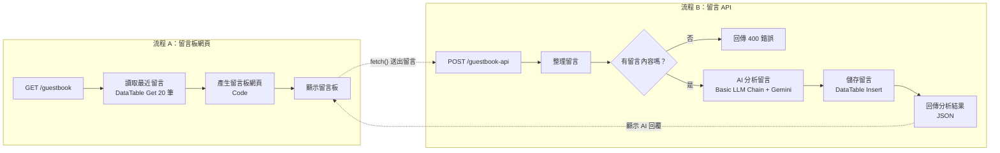

# Webhook 實作
## 範例 6：AI 顧客留言板（打造自己的 AI API）

### 📚 工作流程說明

「午後咖啡館」想在店裡貼一個 QR Code，讓客人用手機留言。每則留言送出後，**AI 會在幾秒內分析情緒、打分數、歸類，並以店長的口吻寫一段回覆**，留言和回覆一起出現在留言牆上，上方還有正面／中立／負面的即時統計。

這個範例把 n8n 同時當成兩種東西：
- **網站**：`GET /webhook/guestbook` 回傳留言板網頁
- **API**：`POST /webhook/guestbook-api` 接收 JSON、回傳 JSON，網頁用 JavaScript `fetch()` 呼叫它

> 💡 範例 3 學過用 `fetch()` 呼叫 n8n；這裡把呼叫的對象換成 AI，再把結果存進 DataTable，留言就不會消失。

---

### 流程架構圖



---

### 工作流程樣版下載

- [📥 AI 顧客留言板 (AI顧客留言板.json)](./AI顧客留言板.json)

---

### 📋 節點詳細說明

#### 流程 A：留言板網頁

1. **開啟留言板（Webhook）**：GET，Path `guestbook`
2. **讀取最近留言（DataTable：Get Row(s)）**
   - Data Table：By Name `顧客留言`，Limit 20，Order By `createdAt` 由新到舊
   - ⚙️ Always Output Data：開啟
3. **產生留言板網頁（Code）**
   - 上方：留言表單（暱稱、留言、送出按鈕）
   - 中間：正面／中立／負面的數量統計
   - 下方：歷史留言，每則顯示情緒標籤、分數、分類與店長回覆
   - 網頁裡的 JavaScript：按下送出 ➔ `fetch('/webhook/guestbook-api', { method: 'POST', body: JSON })` ➔ 把 AI 分析結果顯示在按鈕下方
4. **顯示留言板（Respond to Webhook）**：Text + `Content-Type: text/html`

#### 流程 B：留言 API

5. **接收留言 API（Webhook）**：POST，Path `guestbook-api`，接收 `{ "name": "...", "message": "..." }`
6. **整理留言（Set）**：沒填暱稱用「匿名顧客」，留言最多取 500 字
7. **有留言內容嗎？（IF）**：空的 ➔ 回傳 `400 { ok: false, error: "留言內容不能是空的" }`
8. **AI 分析留言（Basic LLM Chain）**
   - Prompt 規定輸出 5 個欄位與每個欄位的規則（情緒只能三選一、分數 1～5、分類六選一、摘要 20 字內、回覆 60 字內）
   - **Require Specific Output Format**：開啟，連接 **輸出格式**（Structured Output Parser）
9. **Google Gemini Chat Model**：`models/gemini-2.5-flash`，Temperature `0.3`
10. **輸出格式（Structured Output Parser）**：用 JSON 範例定義格式，AI 的回答會變成物件 `$json.output`
    ```json
    { "sentiment": "負面", "score": 2, "category": "服務",
      "summary": "等餐太久且店員態度冷淡",
      "reply": "非常抱歉讓您久等了！我們會加強尖峰時段人力，期待再次為您服務。" }
    ```
11. **儲存留言（DataTable：Insert）**：暱稱、留言與 AI 分析的 5 個欄位
12. **回傳分析結果（Respond to Webhook）**：`{ ok: true, analysis: {...} }`

---

### ⚙️ 使用前準備

1. **建立 DataTable**：名稱 `顧客留言`，欄位如下：

   | 欄位 | 型別 |
   | :--- | :--- |
   | `customer_name` | String |
   | `message` | String |
   | `sentiment` | String |
   | `score` | **Number** |
   | `category` | String |
   | `summary` | String |
   | `reply` | String |

2. **Gemini 憑證**：到 [Google AI Studio](https://aistudio.google.com/) 取得免費 API Key，在 n8n 建立 **Google Gemini(PaLM) Api** 憑證（詳見 [Gemini 與 Gmail 憑證設定](../../雲端資料庫整合/Gemini與Gmail憑證/README.md)）。
3. **匯入工作流**：匯入 [`AI顧客留言板.json`](./AI顧客留言板.json)，Gemini 節點選擇憑證，切換為 **Active**。
4. **打開留言板**：`https://你的網址/webhook/guestbook`，試著留下幾則不同情緒的留言。

---

### 🧪 試試看這些留言

| 留言 | 預期 AI 判斷 |
| :--- | :--- |
| 拿鐵的奶泡超綿密，店員也很親切，下次還會再來！ | 正面、5 分、飲品或服務 |
| 等了 40 分鐘才上餐，而且義大利麵是冷的 | 負面、1～2 分、餐點或服務，回覆先道歉 |
| 位子有點擠，但插座很多適合讀書 | 中立、3 分、環境 |
| 一杯美式要 180 元有點貴 | 負面或中立、價格 |
| （空白直接送出） | 400「留言內容不能是空的」 |

> 💡 打開工作流的 **Executions**，點進任一次執行，可以看到 AI 收到的 Prompt 和原始回答。試著修改 Prompt 的規則（例如回覆改成台語風格、改成 30 字以內），再留言看看差異。

---

### 🎯 學習重點

- **n8n 同時當網站與 API**：同一個工作流提供 HTML 頁面與 JSON API
- **前端 fetch() 呼叫 n8n API**
- **Basic LLM Chain + Structured Output Parser**：讓 AI 回傳固定格式的資料，程式才能接著使用
- **Prompt 中寫清楚規則**：限定選項、字數、語氣
- **DataTable 保存資料**：留言牆不會因為重新整理而消失
- **輸入檢查與錯誤狀態碼**：400 錯誤與錯誤訊息

---

<details>
<summary>🤖 <strong>AI 賦能延伸實作（附 Prompt 提詞）</strong></summary>

> 💡 **任務目標**：負評即時通知店長，並每天寄出留言日報。

**可直接複製給 AI 的 Prompt 提詞**：
```text
請幫我擴充「AI 顧客留言板」工作流程：
1. 在「儲存留言」之後新增 IF 節點：sentiment 為「負面」且 score <= 2 時，
   用 Gmail 寄一封「🚨 收到負評」通知給店長（收件人先填 YOUR_EMAIL@gmail.com），內容包含留言、摘要與 AI 建議回覆；
   不論是否寄信，最後都要接到「回傳分析結果」。
2. 新增 Schedule Trigger（每天 21:00），用 DataTable 讀取今天的留言，
   統計正面／中立／負面數量、平均分數、各分類數量，
   再用 Basic LLM Chain（Gemini）寫 3 點改善建議，用 Gmail 寄出 HTML 日報。
3. 在留言板網頁加上「只看負評」的篩選按鈕（Code 節點產生的網頁中用 JavaScript 隱藏非負面留言）。
請幫我建立節點、撰寫程式碼並完成連線！
```
</details>
