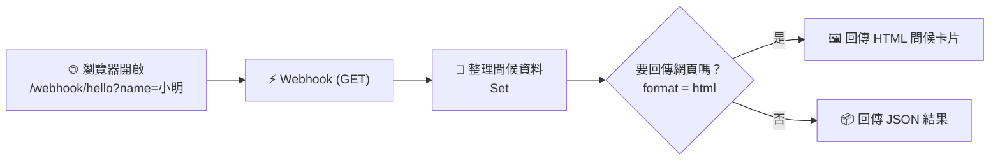

# Webhook 實作
## 範例 1：GET 請求與瀏覽器即時問候（零門檻快速入門）

### 📚 工作流程說明

第一個 Webhook 範例，**不用安裝任何工具**：在瀏覽器網址列輸入網址，就能觸發 n8n 工作流程，並馬上看到 n8n 回傳的結果。

同一個網址可以回傳兩種結果：
- `/webhook/hello?name=小明` ➔ 回傳 **JSON**（給程式看的資料）
- `/webhook/hello?name=小明&format=html` ➔ 回傳 **HTML 網頁**（給人看的畫面）

學會「讓 n8n 回傳網頁」之後，後面的範例都會用這個技巧，讓 n8n 變成手機打得開的小網站。

---

### 流程架構圖



---

### 工作流程樣版下載

- [📥 GET 請求與瀏覽器即時問候樣版 (get_hello_workflow.json)](./get_hello_workflow.json)

---

### ⚠️ 先搞懂：Test URL 與 Production URL

Webhook 節點有兩個網址，這是初學者最常卡關的地方：

| | Test URL | Production URL |
| :--- | :--- | :--- |
| 網址 | `https://你的網址/webhook-test/hello` | `https://你的網址/webhook/hello` |
| 什麼時候能用 | 在編輯器按 **Listen for test event** 之後，**只接收一次** | 工作流右上角切換為 **Active** 之後，**一直都能用** |
| 執行結果 | 直接顯示在畫布上，方便除錯 | 到左側 **Executions** 查看 |
| 適合 | 開發、測試 | 正式給別人使用 |

> 💡 **口訣**：開發用 `webhook-test` + Listen；給別人用 `webhook` + Active。
> 本章從範例 2 開始，網頁裡的表單、按鈕都會呼叫 `/webhook/...`（Production URL），所以**一定要切換為 Active**。

---

### 📋 節點詳細說明

1. **⚡ 接收 GET Webhook 請求（Webhook）**
   - **HTTP Method**：`GET`（瀏覽器網址列預設就是 GET）
   - **Path**：`hello`
   - **Respond**：`Using 'Respond to Webhook' Node`（流程跑完才由 Respond 節點決定回傳什麼）

2. **📝 整理問候資料（Edit Fields / Set）**

   | 欄位 | 值 | 說明 |
   | :--- | :--- | :--- |
   | `userName` | `={{ $json.query.name \|\| '親愛的朋友' }}` | 網址的 `?name=` 參數，沒填就用預設值 |
   | `safeName` | `userName` 經過 HTML 跳脫 | 放進網頁前先把 `<`、`>` 換掉，見下方說明 |
   | `welcomeMessage` | `👋 哈囉 {{ ... }}！` | |
   | `serverTime` | `={{ $now.toFormat('yyyy-MM-dd HH:mm:ss') }}` | |
   | `clientIp` | 從 `x-forwarded-for` Header 取得 | 訪客 IP |
   | `format` | `={{ String($json.query.format \|\| 'json').toLowerCase() }}` | 要回傳 html 還是 json |

3. **要回傳網頁嗎？（IF）**：`format` 等於 `html`

4. **🖼️ 回傳 HTML 問候卡片（Respond to Webhook）**
   - **Respond With**：Text，**Response Body**：一段 HTML，用 `{{ $json.safeName }}` 帶入姓名
   - **Options ➔ Response Headers**：`Content-Type` = `text/html; charset=utf-8`
   - 💡 少了這個 Header，瀏覽器會把 HTML 原始碼當成純文字顯示。

5. **📦 回傳 JSON 結果（Respond to Webhook）**
   - **Respond With**：JSON
   - **Response Body**：`={{ JSON.stringify({ status: 'success', message: $json.welcomeMessage, ... }) }}`
   - 用 `JSON.stringify` 組 JSON，名字裡有引號 `"` 也不會讓 JSON 格式壞掉。

---

### 🧪 測試與驗證方法

1. 將右上角切換為 **Active**，複製 Webhook 節點的 **Production URL**。
2. 瀏覽器開啟（JSON 版）：
   ```text
   https://<你的網址>/webhook/hello?name=小明
   ```
   ```json
   {
     "status": "success",
     "message": "👋 哈囉 小明！恭喜您成功觸發第一個 n8n Webhook！",
     "visitor": "小明",
     "server_time": "2026-11-20 20:30:00",
     "client_ip": "1.2.3.4",
     "tip": "🎉 在網址加上 &format=html，改看網頁版！"
   }
   ```
3. 網址後面加上 `&format=html`，畫面變成一張問候卡片。
4. 用手機打開同一個網址（需要外部網址，見 [ngrok 安裝](../../ngrok安裝/) 或 [Cloudflare Tunnel](../../cloudflare_tunnel/)）。

---

### 🛡️ 為什麼要做 HTML 跳脫？

試試看這個網址：

```text
/webhook/hello?format=html&name=<h1 style="color:red">我是駭客</h1>
```

如果直接把 `name` 放進網頁，瀏覽器會把它當成 HTML 執行，畫面就被別人改掉了。更危險的是放進 `<script>`，就能在別人的瀏覽器執行程式，這叫做 **XSS（跨網站指令碼攻擊）**。

`safeName` 把 `<` 換成 `&lt;`、`>` 換成 `&gt;`，瀏覽器就只會把它當成文字顯示。**只要是使用者輸入、要放進網頁的內容，都要先跳脫。**

---

### 🎯 學習重點

- **Webhook GET 方法**：瀏覽器網址列就是最簡單的測試工具
- **Query 參數**：`{{ $json.query.參數名 }}`
- **Respond to Webhook 回傳 JSON 或 HTML**：`Content-Type` 決定瀏覽器怎麼顯示
- **Test URL 與 Production URL 的差別**
- **預設值**：`|| '預設值'` 避免沒傳參數時出錯
- **HTML 跳脫**：防止 XSS

---

<details>
<summary>🤖 <strong>AI 賦能延伸實作（附 Prompt 提詞）</strong></summary>

> 💡 **任務目標**：讓問候卡片依照時間顯示早安／午安／晚安，並加上當地天氣。

**可直接複製給 AI 的 Prompt 提詞**：
```text
請幫我升級「GET 請求與瀏覽器即時問候」工作流程：
1. 保持 Webhook（GET /hello），新增 city 參數（例如 ?name=小明&city=Taipei&format=html）。
2. 在「整理問候資料」之後新增 HTTP Request 節點，呼叫 https://wttr.in/{{ city }}?format=j1 取得目前氣溫與天氣描述。
3. 新增 Code 節點依台灣時間判斷問候語：05:00–11:59 早安、12:00–17:59 午安、其他時間晚安。
4. HTML 問候卡片改為顯示「早安，小明！台北現在 23°C，多雲」，背景顏色依早／午／晚變化。
5. JSON 回應也加上 greeting、city、temperature、weather 欄位。
請幫我建立節點、設定表達式並完成連線！
```
</details>
