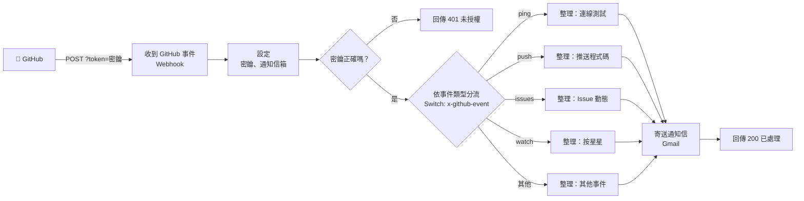

# Webhook 實作
## 範例 5：GitHub 事件通知與安全驗證（真實第三方服務呼叫 n8n）

### 📚 工作流程說明

前面的範例都是「人」用瀏覽器呼叫 n8n。但 Webhook 最常見的用途，是讓**別的服務在事情發生時主動通知你**：金流收到付款、表單有人填寫、GitHub 有人推送程式碼……

這個範例把 n8n 的網址設定到你的 GitHub 專案，之後只要：
- 🚀 有人**推送程式碼**（push）
- 🐛 有人**開 Issue 或關閉 Issue**
- ⭐ 有人**幫專案按星星**

GitHub 就會在幾秒內呼叫 n8n，n8n 依事件類型整理成不同的通知信寄給你。在 GitHub 網頁上按一下星星，手機馬上收到 Email，非常有感！

同時學習兩件 API 必備的事：
1. **安全驗證**：網址是公開的，任何人都能呼叫。沒帶正確密鑰的請求一律回傳 `401`。
2. **事件分流**：同一個網址會收到各種事件，用 **Switch** 依 Header `x-github-event` 分別處理。

---

### 流程架構圖



---

### 工作流程樣版下載

- [📥 GitHub 事件通知與安全驗證 (GitHub事件通知與安全驗證.json)](./GitHub事件通知與安全驗證.json)

---

### 📋 節點詳細說明

1. **收到 GitHub 事件（Webhook）**
   - **HTTP Method**：POST，**Path**：`github-events`
   - GitHub 送來的資料：
     - `$json.headers['x-github-event']`：事件類型（`push`、`issues`、`watch`、`ping`…）
     - `$json.body`：事件內容（誰、哪個專案、做了什麼）
     - `$json.query.token`：我們自己加在網址上的密鑰

2. **設定（Set）**
   - `secret_token`：⚠️ 改成一組只有你知道的密鑰
   - `notify_email`：⚠️ 改成你的 Email
   - **Include Other Input Fields**：開啟（保留 Webhook 收到的 headers、body、query）

3. **密鑰正確嗎？（IF）**：`{{ $json.query.token }}` 等於 `{{ $json.secret_token }}`
   - 不正確 ➔ **回傳 401 未授權**（Respond to Webhook，Response Code `401`）

4. **依事件類型分流（Switch）**

   | 規則 | `x-github-event` | 輸出 |
   | :--- | :--- | :--- |
   | 1 | `ping` | 連線測試（GitHub 剛設定好 Webhook 時會送一次） |
   | 2 | `push` | 推送程式碼 |
   | 3 | `issues` | Issue 動態 |
   | 4 | `watch` | 按星星（GitHub 的「按星星」事件名稱是 watch） |
   | Fallback | 其他 | 其他事件 |

5. **整理：○○（Code，共 5 個）**：每種事件的資料結構不同，各自整理出 `subject` 與 `html`：
   - **push**：推送者、專案、分支、每個 commit 的作者與訊息、查看變更的連結
   - **issues**：誰、開啟／關閉了哪個 Issue、內容前 300 字
   - **watch**：按星星的人（含大頭貼）、專案目前總星星數
   - 所有來自 GitHub 的文字都先做 HTML 跳脫再放進信件

6. **寄送通知信（Gmail）**：5 個 Code 節點都接到同一個 Gmail 節點
7. **回傳 200 已處理（Respond to Webhook）**：GitHub 收到 200 才會把這次呼叫標記為成功 ✅

---

### ⚙️ 使用前準備

1. **準備外部網址**：GitHub 在網路上，要連得到你的 n8n。用 [ngrok](../../ngrok安裝/)、[Cloudflare Tunnel](../../cloudflare_tunnel/) 或 n8n Cloud。
2. **Gmail 憑證**：參考 [Google Cloud API 服務設定指南](../../google_cloud設定/README.md)。
3. **匯入工作流**：匯入 [`GitHub事件通知與安全驗證.json`](./GitHub事件通知與安全驗證.json)，修改「設定」節點的 `secret_token`、`notify_email`，Gmail 節點選擇憑證，切換為 **Active**。
4. **在 GitHub 設定 Webhook**：
   1. 到自己的任一個 GitHub 專案（沒有就新建一個，例如 `n8n-webhook-test`）
   2. **Settings** ➔ **Webhooks** ➔ **Add webhook**
   3. 填寫：

      | 欄位 | 值 |
      | :--- | :--- |
      | **Payload URL** | `https://你的網址/webhook/github-events?token=你的密鑰` |
      | **Content type** | ⚠️ 選 **`application/json`**（預設的 form 格式，n8n 收到的 body 會是一串文字） |
      | **Secret** | 留空（本範例用網址上的 token 驗證，進階做法見下方） |
      | **Which events** | 選 **Let me select individual events**，勾選 **Pushes**、**Issues**、**Stars** |

   4. 按 **Add webhook**，GitHub 會馬上送一個 `ping` 事件 ➔ 你應該收到「✅ GitHub Webhook 設定成功」的信。
5. **觸發事件**：
   - 在 GitHub 網頁上直接編輯 README 並 Commit ➔ 收到 🚀 推送通知
   - 到 **Issues** 開一個新 Issue ➔ 收到 🐛 通知
   - 幫專案按星星（或請同學幫你按）➔ 收到 ⭐ 通知

> 💡 GitHub 的 Webhook 設定頁有 **Recent Deliveries** 分頁，可以看到每一次呼叫的 Request、Response 和狀態碼，還能按 **Redeliver** 重送，是除錯的好工具。

---

### 🧪 沒有外部網址？用 curl 模擬 GitHub

```bash
# 模擬「按星星」事件（密鑰正確）
curl -X POST "http://localhost:5678/webhook/github-events?token=請改成你自己的密鑰-2026" \
  -H "Content-Type: application/json" \
  -H "X-GitHub-Event: watch" \
  -d '{"action":"started","sender":{"login":"同學A","avatar_url":""},"repository":{"name":"demo","full_name":"me/demo","stargazers_count":5}}'

# 密鑰錯誤 ➔ 應該回傳 401
curl -i -X POST "http://localhost:5678/webhook/github-events?token=wrong" \
  -H "Content-Type: application/json" -H "X-GitHub-Event: push" -d '{}'
```

---

### 🔐 進階：GitHub 官方的簽章驗證

把密鑰放在網址上簡單易懂，但網址可能出現在記錄檔裡。GitHub 官方的做法是在 **Secret** 欄位填密鑰，GitHub 會用它對整個 body 計算 **HMAC-SHA256**，放在 Header `X-Hub-Signature-256`。接收端用同一把密鑰重新計算，比對結果相同才處理。

在 n8n 中的做法：Webhook 節點 **Options ➔ Raw Body** 開啟，用 **Crypto** 節點（Action: Hmac、Type: SHA256）對原始 body 計算簽章，再用 IF 比對 `sha256=` + 計算結果是否等於 Header 的值。金流（例如綠界、Stripe）的通知也都是類似的驗證方式。

---

### 🎯 學習重點

- **第三方服務主動呼叫 n8n**：Webhook 真正的用途
- **安全驗證**：公開網址必須驗證來源，失敗回傳 `401`
- **從 Header 判斷事件類型**：`$json.headers['x-github-event']`
- **Switch 多路分流** 與 **Fallback** 處理未知事件
- **多個分支匯流到同一個節點**
- **回傳正確狀態碼**：讓呼叫端知道處理成功與否

---

<details>
<summary>🤖 <strong>AI 賦能延伸實作（附 Prompt 提詞）</strong></summary>

> 💡 **任務目標**：讓 AI 幫忙看每次推送的內容，並把所有事件記錄到 DataTable 做成專案動態牆。

**可直接複製給 AI 的 Prompt 提詞**：
```text
請幫我擴充「GitHub 事件通知與安全驗證」工作流程：
1. 在「整理：推送程式碼」之後加入 Basic LLM Chain（Google Gemini Chat Model），
   根據所有 commit 訊息，用繁體中文寫一段 50 字以內的「這次更新摘要」，放進通知信的最上方。
2. 在「寄送通知信」之前，新增 DataTable Insert 節點，把每個事件寫入 DataTable「GitHub動態」
   （欄位：event、actor、repo、summary、url）。
3. 新增一個 Webhook（GET /github-wall），讀取 DataTable 最近 30 筆事件，
   用 Code 節點產生 HTML 動態牆（依事件類型顯示 🚀🐛⭐ 圖示與時間），用 Respond to Webhook 回傳。
請幫我建立節點、撰寫程式碼並完成連線！
```
</details>
