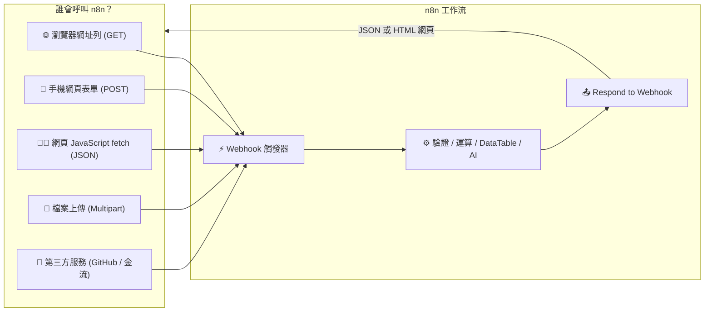

# 🔗 整合 Webhook 的實作

Webhook 讓外部的瀏覽器、手機、網頁或雲端服務，透過一個網址就能即時觸發 n8n 工作流程。搭配 **Respond to Webhook** 節點回傳 JSON 或 HTML，n8n 就變成你的**專屬 API 伺服器，甚至是一個手機打得開的小網站**。

本章每個範例都是一個**看得到、摸得到**的成果：瀏覽器打開就是網頁、全班手機一起掃碼簽到、在 GitHub 按個星星手機就收到通知。只需要瀏覽器，不用學 curl 也能完成每個範例。

> 💡 **AI 協作時代學習法**：在學習完基礎節點操作並透過 MCP 連線 AI（Gemini、ChatGPT 或 Claude）後，您可以直接複製每個範例下方的 **「AI 賦能延伸實作」** 折疊區塊（`<details>`）內的 Prompt，交由 AI 助理替您在畫布上全自動建構與擴充進階邏輯！

---

## 📚 什麼是 Webhook？

- **傳統 API 輪詢（Pull）**：每隔幾秒主動去問「有新資料嗎？」，浪費資源又有延遲。
- **Webhook 即時推播（Push）**：事情發生的那一刻，對方主動呼叫你的網址把資料「推」過來。



---

## 🔑 前置準備

- **外部網址**：範例 2、5 需要讓學生手機或 GitHub 連到你的 n8n。本機架設請先完成 [ngrok 安裝](../ngrok安裝/) 或 [Cloudflare Tunnel](../cloudflare_tunnel/)；使用 n8n Cloud 則不需要。
- **DataTable**：範例 2、6 使用 n8n 內建的 DataTable 儲存資料，操作方式可複習 [初階範例：DataTable](../初階範例/DataTable/README.md)。
- **Google 憑證**：範例 5（Gmail）、7（Google Drive）需要 [Google Cloud OAuth 設定](../google_cloud設定/README.md)；範例 6 需要 [Gemini API Key](../雲端資料庫整合/Gemini與Gmail憑證/README.md)。

---

## 📚 實作範例導覽

| # | 範例 | 呼叫者 | 有感的地方 | 核心技術 |
| :-: | :--- | :--- | :--- | :--- |
| 1 | GET 請求與瀏覽器即時問候 | 瀏覽器網址列 | 改網址就看到不同結果 | GET、Query、回傳 JSON 與 HTML |
| 2 | 全班 QR Code 簽到 | 全班的手機 | 投影幕上名單即時跳出來 | 多個 Webhook、HTML 表單、DataTable |
| 3 | 互動式網頁表單與個人化問候 | 網頁 JavaScript | 附精美測試台網頁 | POST、fetch、狀態碼 200/400 |
| 4 | 網頁上傳成績單報表 | 網頁上傳檔案 | 上傳自己班的成績單 | multipart、Binary、Extract from File |
| 5 | GitHub 事件通知與安全驗證 | GitHub | 按個星星手機就收到信 | 第三方 Webhook、401、Switch |
| 6 | AI 顧客留言板 | 網頁 fetch API | AI 幾秒內回覆每則留言 | LLM Chain、結構化輸出、DataTable |
| 7 | Webhook 自製訂便當網站 | 同事的手機 | 改菜單 Excel 網頁就更新 | 動態網頁、Google Drive、Static Data |

---

### 1. [範例 1：GET 請求與瀏覽器即時問候（零門檻快速入門）](./GET請求與瀏覽器即時問候/README.md)

**難度**：入門級 🟢 ｜ **亮點**：瀏覽器輸入網址就有結果，加上 `&format=html` 立刻變成網頁！

第一個 Webhook：解析網址參數，同一個網址可以回傳 JSON（給程式）或 HTML 問候卡片（給人看）。也在這裡搞懂最常卡關的 **Test URL 與 Production URL**。

**學習重點**：
- Webhook GET 方法與 Query 參數 `{{ $json.query.name }}`
- Respond to Webhook 回傳 JSON 與 HTML（`Content-Type: text/html`）
- Test URL（Listen 一次）vs Production URL（Active 常駐）
- HTML 跳脫，防止 XSS

- **附帶樣版**：[`get_hello_workflow.json`](./GET請求與瀏覽器即時問候/get_hello_workflow.json)

<details>
<summary>🤖 <strong>AI 賦能延伸實作（附 Prompt 提詞）</strong></summary>

> 💡 **任務目標**：問候卡片依時間顯示早安／午安／晚安，並加上當地天氣。

**可直接複製給 AI 的 Prompt 提詞**：
```text
請幫我升級「GET 請求與瀏覽器即時問候」工作流程：
1. 保持 Webhook（GET /hello），新增 city 參數（例如 ?name=小明&city=Taipei&format=html）。
2. 在「整理問候資料」之後新增 HTTP Request 節點，呼叫 https://wttr.in/{{ city }}?format=j1 取得目前氣溫與天氣描述。
3. 新增 Code 節點依台灣時間判斷問候語：05:00–11:59 早安、12:00–17:59 午安、其他時間晚安。
4. HTML 問候卡片改為顯示「早安，小明！台北現在 23°C，多雲」，背景顏色依早／午／晚變化。
5. JSON 回應也加上 greeting、city、temperature、weather 欄位。
請幫我建立節點、設定表達式並完成連線！
```
</details>

---

### 2. [範例 2：全班 QR Code 簽到（全班一起動手）](./全班QRCode簽到/README.md)

**難度**：初級 🟢 ｜ **亮點**：老師投影 QR Code，全班手機掃碼簽到，名單每 5 秒即時更新！

3 個 Webhook 組成一個完整系統：老師看板（QR Code + 即時名單）、學生簽到頁、送出簽到（檢查重複後寫入 DataTable）。

**學習重點**：
- 一個系統 = 多個 Webhook（GET 顯示頁面、POST 接收表單）
- HTML 表單送出的資料在 `$json.body`
- DataTable 篩選查詢、寫入，防止重複簽到
- Always Output Data 處理「查無資料」
- 從 Request Header 自動組出網址並產生 QR Code

- **附帶樣版**：[`全班QRCode簽到.json`](./全班QRCode簽到/全班QRCode簽到.json)

<details>
<summary>🤖 <strong>AI 賦能延伸實作（附 Prompt 提詞）</strong></summary>

> 💡 **任務目標**：只允許名單上的學生簽到、標記遲到，並在中午寄出缺席名單。

**可直接複製給 AI 的 Prompt 提詞**：
```text
請幫我擴充「全班 QR Code 簽到」工作流程：
1. 我會先建立 DataTable「學生名單」（欄位 student_id、name、email）。
2. 在「資料完整嗎？」之後，用 DataTable Get 查詢學生名單中是否有這個 student_id；沒有的話回傳「查無此學號」的 HTML 頁面（狀態碼 404）。
3. 在「設定」節點加上 start_time（例如 09:10），簽到時間晚於 start_time 時寫入 status = "遲到"，否則為 "準時"；看板上遲到的同學用橘色顯示。
4. 新增 Schedule Trigger（每天 12:00），比對學生名單與今天的簽到紀錄，用 Gmail 寄出「今日缺席名單」給老師。
請幫我建立節點、設定篩選條件並完成連線！
```
</details>

---

### 3. [範例 3：互動式網頁表單與個人化問候系統（POST 與前端互動串接）](./自動化問候系統/README.md)

**難度**：初級 🟢 ｜ **亮點**：附帶完整 HTML5/CSS3 測試台網頁，即時顯示延遲與 200/400 狀態碼！

前端網頁用 JavaScript `fetch()` 送出 JSON，n8n 驗證資料後回傳成功或錯誤訊息，學會 API 的請求與回應。

**學習重點**：
- Webhook 接收 POST JSON Body（`{{ $json.body.name }}`）
- IF 節點驗證資料，分別回傳 200 與 400 狀態碼
- 前端 fetch API 與 n8n Webhook 串接

- **附帶樣版**：[`教學範例_自動化問候系統.json`](./自動化問候系統/教學範例_自動化問候系統.json)
- **網頁原始碼**：[website/ 前端介面原始碼](./自動化問候系統/website/)

<details>
<summary>🤖 <strong>AI 賦能延伸實作（附 Prompt 提詞）</strong></summary>

> 💡 **任務目標**：依據當前時間（早安/午安/晚安）與性別動態生成客製化問候語。

**可直接複製給 AI 的 Prompt 提詞**：
```text
請幫我在目前的「自動化問候系統」工作流程中進行延伸升級：
1. 保持原本的 Webhook 觸發器（POST /greeting）。
2. 在「檢查姓名」後，加入 Code 節點判斷當前時間：早上 (05:00 - 11:59) 早安、下午 (12:00 - 17:59) 午安、晚上 (18:00 - 04:59) 晚安。
3. 若輸入資料包含 gender: "male" 或 "female"，問候語分別加上「先生」或「小姐」。
4. 整理輸出為：greeting（問候語）、client_ip（來自 headers 的 IP）、timestamp。
5. 最後透過 Respond to Webhook 回傳 200 JSON 結果。
請幫我建立相關節點與運算邏輯！
```
</details>

---

### 4. [範例 4：網頁上傳成績單報表（檔案上傳與自動分析）](./網頁上傳成績單報表/README.md)

**難度**：中級 🟡 ｜ **亮點**：網頁選檔上傳，立刻得到各科平均、及格率、前五名與補救名單！

用網頁上傳 CSV 成績單，n8n 自動判斷姓名與科目欄位、完成統計，回傳排版好的 HTML 報表。可以拿自己班上的成績單來試。

**學習重點**：
- `multipart/form-data` 上傳檔案與 Binary 資料（`$binary`）
- Extract from File 將 CSV 轉為 JSON
- Code 節點做資料分析（平均、極值、及格率、排名）
- 動態判斷欄位，處理不同格式的資料

- **附帶樣版**：[`網頁上傳成績單報表.json`](./網頁上傳成績單報表/網頁上傳成績單報表.json)、[`學生成績單.csv`](./網頁上傳成績單報表/學生成績單.csv)

<details>
<summary>🤖 <strong>AI 賦能延伸實作（附 Prompt 提詞）</strong></summary>

> 💡 **任務目標**：報表加上 AI 班級學習分析，並提供 Excel 下載。

**可直接複製給 AI 的 Prompt 提詞**：
```text
請幫我擴充「網頁上傳成績單報表」工作流程：
1. 在「計算統計並產生報表」的 Code 節點中，另外輸出 stats 物件（各科平均、及格率、前五名、補救名單）。
2. 新增 Basic LLM Chain 節點（Google Gemini Chat Model），以導師的角度根據 stats 寫一段 150 字以內的班級學習分析與教學建議。
3. 把 AI 分析放在報表最下方「🤖 AI 學習分析」區塊。
4. 在報表中提供「下載含總分與排名的 Excel」：用 Convert to File 產生 xlsx，透過 Respond to Webhook（Respond With: Binary File）回傳。
請幫我建立節點、撰寫程式碼並完成連線！
```
</details>

---

### 5. [範例 5：GitHub 事件通知與安全驗證（真實第三方服務呼叫 n8n）](./GitHub事件通知與安全驗證/README.md)

**難度**：中高級 🟠 ｜ **亮點**：在 GitHub 按星星、開 Issue、推送程式碼，幾秒內收到 Email 通知！

把 n8n 網址設定到 GitHub 專案，讓真實的第三方服務主動呼叫 n8n。密鑰錯誤回傳 401，再依 `x-github-event` 用 Switch 分流處理。

**學習重點**：
- 第三方服務主動呼叫 Webhook
- 密鑰驗證與 `401 Unauthorized`
- 從 Header 判斷事件類型，Switch 多路分流與 Fallback
- 多個分支匯流到同一個節點
- 進階：HMAC 簽章驗證的觀念

- **附帶樣版**：[`GitHub事件通知與安全驗證.json`](./GitHub事件通知與安全驗證/GitHub事件通知與安全驗證.json)

<details>
<summary>🤖 <strong>AI 賦能延伸實作（附 Prompt 提詞）</strong></summary>

> 💡 **任務目標**：AI 摘要每次推送的內容，並把所有事件做成專案動態牆。

**可直接複製給 AI 的 Prompt 提詞**：
```text
請幫我擴充「GitHub 事件通知與安全驗證」工作流程：
1. 在「整理：推送程式碼」之後加入 Basic LLM Chain（Google Gemini Chat Model），根據所有 commit 訊息寫一段 50 字以內的「這次更新摘要」，放進通知信最上方。
2. 在「寄送通知信」之前，新增 DataTable Insert，把每個事件寫入 DataTable「GitHub動態」（欄位：event、actor、repo、summary、url）。
3. 新增 Webhook（GET /github-wall），讀取最近 30 筆事件，用 Code 節點產生 HTML 動態牆，用 Respond to Webhook 回傳。
請幫我建立節點、撰寫程式碼並完成連線！
```
</details>

---

### 6. [範例 6：AI 顧客留言板（打造自己的 AI API）](./AI顧客留言板/README.md)

**難度**：高級 🔴 ｜ **亮點**：客人留言後，AI 幾秒內分析情緒、打分數並以店長口吻回覆！

n8n 同時是網站（留言板網頁）與 API（`fetch()` 呼叫的 JSON API）。Gemini 用結構化輸出分析每則留言，結果存進 DataTable 形成留言牆。

**學習重點**：
- 同一個工作流提供 HTML 頁面與 JSON API
- Basic LLM Chain + Structured Output Parser 回傳固定格式資料
- 在 Prompt 中限定選項、字數與語氣
- DataTable 保存資料、輸入檢查與 400 錯誤

- **附帶樣版**：[`AI顧客留言板.json`](./AI顧客留言板/AI顧客留言板.json)

<details>
<summary>🤖 <strong>AI 賦能延伸實作（附 Prompt 提詞）</strong></summary>

> 💡 **任務目標**：負評即時通知店長，並每天寄出留言日報。

**可直接複製給 AI 的 Prompt 提詞**：
```text
請幫我擴充「AI 顧客留言板」工作流程：
1. 在「儲存留言」之後新增 IF 節點：sentiment 為「負面」且 score <= 2 時，用 Gmail 寄「🚨 收到負評」通知給店長；不論是否寄信，最後都要接到「回傳分析結果」。
2. 新增 Schedule Trigger（每天 21:00），讀取今天的留言，統計各情緒數量與平均分數，再用 Basic LLM Chain（Gemini）寫 3 點改善建議，用 Gmail 寄出 HTML 日報。
3. 在留言板網頁加上「只看負評」的篩選按鈕。
請幫我建立節點、撰寫程式碼並完成連線！
```
</details>

---

### 7. [範例 7：Webhook 自製訂便當網站（綜合實戰）](./Webhook自製訂便當網站/README.md)

**難度**：高級 🔴 ｜ **亮點**：n8n 自己當網站！手機打開網址就能訂便當，菜單來自 Google Drive 的 Excel，訂單自動累積成今天的 Excel 檔！

用兩個 Webhook 組成一個完整網站：GET 從 Google Drive 讀取菜單、產生互動式訂購網頁；POST 接收訂單、累積當日訂單並上傳／更新到 Google Drive。README 附「這個系統還有哪些問題？」課堂討論題。

**學習重點**：
- Code 節點依 Excel 菜單動態產生網頁，瀏覽器端 JavaScript 即時計算金額
- `$getWorkflowStaticData` 跨執行保存當日訂單
- Google Drive 檔案「新增或更新」判斷
- 安全思考：為什麼不能相信前端傳來的價格

- **附帶樣版**：[`訂便當網站.json`](./Webhook自製訂便當網站/訂便當網站.json)、[`便當店菜單.xlsx`](./Webhook自製訂便當網站/便當店菜單.xlsx)

<details>
<summary>🤖 <strong>AI 賦能延伸實作（附 Prompt 提詞）</strong></summary>

> 💡 **任務目標**：修正「價格可被竄改」的安全問題，加上每日截止時間，並在 10:30 自動寄出訂單彙整。

**可直接複製給 AI 的 Prompt 提詞**：
```text
請幫我改進「Webhook 自製訂便當網站」工作流程：
1. 後端驗證價格：在「累積當日訂單」之前重新下載便當店菜單.xlsx，依 便當店 + 餐點名稱 找出正確價格並重算 單價 與 總金額，找不到或已停售時回傳 400 錯誤頁面。
2. 截止時間：在兩個 Webhook 之後各加一個 IF 節點，台灣時間超過 10:30 時回傳「今日訂餐已截止」的 HTML 頁面。
3. 每日彙整：新增 Schedule Trigger（每天 10:30），讀取 Workflow Static Data 中今天的訂單，依便當店分組統計，用 Gmail 寄出 HTML 表格給行政人員。
請幫我建立節點、撰寫程式碼並完成連線！
```
</details>

---

## 🔧 Webhook 核心觀念與設定重點

### 1. Test URL vs Production URL
* **Test URL (`/webhook-test/...`)**：在編輯器按「Listen for test event」後只接收**一次**請求，結果直接顯示在畫布上，適合開發除錯。
* **Production URL (`/webhook/...`)**：工作流右上角切換為 **Active** 後才會常駐監聽，執行結果到 **Executions** 查看。
* 範例 2～7 的網頁都呼叫 `/webhook/...`，**請記得切換為 Active**。

### 2. 資料存取路徑
* **GET 查詢參數**：`{{ $json.query.參數名稱 }}`
* **POST Body（表單或 JSON）**：`{{ $json.body.欄位名稱 }}`
* **Headers**：`{{ $json.headers['x-github-event'] }}`
* **上傳的檔案**：在 Binary 分頁，表達式用 `$binary`

### 3. Response Mode（回應模式）
* **Immediately（預設）**：收到請求立刻回傳 200，後續節點在背景執行（適合耗時的背景任務）。
* **Using 'Respond to Webhook' Node**：流程跑完才由 Respond to Webhook 回傳內容與狀態碼（本章所有範例都用這個）。

### 4. 回傳網頁的三個要點
* **Respond With** 選 Text，內容放 HTML
* **Response Headers** 加上 `Content-Type: text/html; charset=utf-8`
* 使用者輸入的內容放進網頁前，先做 **HTML 跳脫**（`<` ➔ `&lt;`），防止 XSS

---

## 📁 舊版範例

改版前的範例（電商購物車計算、curl 檔案上傳、API 金鑰多事件分流、OpenAI 文字分析微服務）保留在 [舊版範例](./舊版範例/README.md)，僅供參考。
