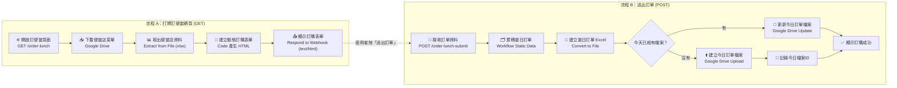
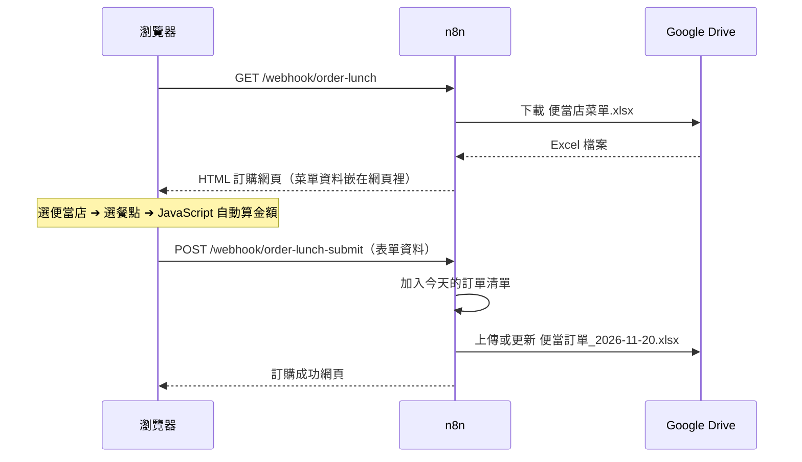

# Webhook 實作
## 範例 7：Webhook 自製訂便當網站（綜合實戰）

### 📚 工作流程說明

前面的範例都是用 curl 或現成網頁「呼叫」n8n；這個範例反過來，**讓 n8n 自己當網站**。

同事用手機打開一個網址，就看到一個訂便當網頁：便當店和餐點是從 Google Drive 上的菜單 Excel 即時讀出來的，選好餐點會自動算出金額，送出後訂單會累積到 Google Drive 上「今天的訂單 Excel」。行政人員要改菜單，只要改 Excel，網頁就自動更新。

| 一般網站 | 這個範例 |
| :--- | :--- |
| 要租主機、寫後端程式 | n8n 的 Webhook 就是網址 |
| 菜單存在資料庫 | 菜單存在 Google Drive 的 Excel |
| 後端程式產生 HTML | Code 節點產生 HTML，Respond to Webhook 回傳 |
| 訂單寫入資料庫 | 訂單寫入 Google Drive 的 Excel |

---

### 流程架構圖





---

### 工作流程樣版下載

- [📥 訂便當網站工作流程 (訂便當網站.json)](./訂便當網站.json)
- [📊 便當店菜單範例 (便當店菜單.xlsx)](./便當店菜單.xlsx)：3 家店、15 個餐點，其中 2 個標記為「暫停供應／停售」

---

### 📋 節點詳細說明

#### 流程 A：打開訂便當網頁

1. **🌐 開啟訂便當頁面（Webhook）**
   - **HTTP Method**：GET，**Path**：`order-lunch`
   - **Respond**：`Using 'Respond to Webhook' Node`

2. **📥 下載便當店菜單（Google Drive：Download）**
   - **File**：By ID，貼上 `便當店菜單.xlsx` 的檔案 ID（Google Drive 網址 `https://drive.google.com/file/d/【這一段】/view`）

3. **📊 取出便當店資料（Extract from File：XLSX）**
   - 把 Excel 的每一列轉成一筆資料，第一列當欄位名稱。

4. **🧩 建立動態訂購表單（Code）**
   - 用正規表達式找出欄位：`便當店名稱`、`餐點名稱`、`價格`、`供應狀態`（欄位名稱稍有不同也找得到）
   - 過濾掉「暫停／停售／停供」的餐點
   - 把菜單資料用 `JSON.stringify` 嵌進網頁的 `<script>`，選便當店時，瀏覽器端的 JavaScript 會即時切換餐點選單、計算總金額
   - `<form method="post" action="/webhook/order-lunch-submit">`：表單送出到流程 B 的網址

5. **📤 顯示訂購表單（Respond to Webhook）**
   - **Respond With**：Text，**Response Body**：`={{ $json.html }}`
   - **Response Headers**：`Content-Type: text/html; charset=utf-8`
   - 💡 **關鍵**：少了這個 Header，瀏覽器會把 HTML 當成純文字顯示，看到的是一堆原始碼。

#### 流程 B：送出訂單

6. **📨 接收訂單資料（Webhook）**
   - **HTTP Method**：POST，**Path**：`order-lunch-submit`
   - HTML 表單送出的資料會出現在 `$json.body`，欄位名稱就是 `<input name="...">`，例如 `$json.body['姓名']`。

7. **🗂️ 累積當日訂單（Code）**
   - `$getWorkflowStaticData('global')`：工作流的「小記事本」，執行結束後資料還會保留。
   - 記住三件事：今天日期 `orderDate`、今天所有訂單 `orders`、今天的 Excel 檔案 ID `fileId`。
   - 換日時自動清空，重新開始累積。
   - 每次輸出「今天全部訂單」，下一步才能產生完整的 Excel。

8. **📄 建立當日訂單 Excel（Convert to File：XLSX）**
   - 檔名 `便當訂單_2026-11-20.xlsx`，工作表名稱「訂單」。

9. **判斷是否已有今日檔案（IF）**
   - `現有檔案ID` 不是空的 ➔ 更新檔案；是空的 ➔ 建立新檔案。

10. **⬆️ 建立今日訂單檔案（Google Drive：Upload）** ➔ **💾 記錄今日檔案ID（Code）**
    - 今天第一張訂單時上傳新檔案，並把檔案 ID 存進 Static Data，之後的訂單都改成更新同一個檔案。

11. **🔄 更新今日訂單檔案（Google Drive：Update）**
    - **Change File Content**：開啟，用新的 Excel 覆蓋舊內容。

12. **✅ 顯示訂購成功（Respond to Webhook）**
    - 回傳一個漂亮的 HTML 成功頁面。

---

### ⚙️ 使用前準備

1. **Google Drive 憑證**：依照 [Google Cloud API 服務設定指南](../../google_cloud設定/README.md) 啟用 Google Drive API，並在 n8n 建立 **Google Drive OAuth2** 憑證。
2. **上傳菜單**：把 [`便當店菜單.xlsx`](./便當店菜單.xlsx) 上傳到 Google Drive，複製檔案 ID。
3. **建立訂單資料夾**：在 Google Drive 建立一個資料夾（例如「便當訂單」），從網址複製資料夾 ID（`https://drive.google.com/drive/folders/【這一段】`）。
4. **匯入工作流**：匯入 [`訂便當網站.json`](./訂便當網站.json)。
5. **修改節點**：
   - 「下載便當店菜單」：File ID 貼上菜單檔案 ID
   - 「建立今日訂單檔案」：Parent Folder 貼上資料夾 ID
   - 三個 Google Drive 節點都選擇你的 Google Drive 憑證
6. **啟用工作流**：右上角切換為 **Active**。
7. **用手機打開**：`https://你的n8n網址/webhook/order-lunch`（Production URL），試著訂兩三個便當，再到 Google Drive 的資料夾看今天的訂單 Excel。

> ⚠️ **為什麼一定要 Active、不能用 Test URL？**
> 1. 網頁表單寫死送到 `/webhook/order-lunch-submit`（Production URL），Test URL 的路徑是 `/webhook-test/...`，送不到。
> 2. `$getWorkflowStaticData` **只有正式執行（Active 狀態被觸發）才會保存**。用編輯器手動測試時資料不會留下來，每一張訂單都會被當成今天第一張，建立出一堆只有一筆資料的 Excel。

> 💡 本機架設的 n8n 想讓同事用手機訂便當，需要先建立外部網址，參考 [ngrok 安裝](../../ngrok安裝/) 或 [Cloudflare Tunnel](../../cloudflare_tunnel/)。

---

### 🎯 學習重點

- **Webhook 回傳 HTML**：Respond to Webhook + `Content-Type: text/html`，n8n 就是網頁伺服器
- **一個網站 = 兩個 Webhook**：GET 顯示頁面、POST 接收資料
- **伺服器端產生網頁**：Code 節點把資料組進 HTML，類似 PHP / JSP 的做法
- **Excel 當資料來源**：非工程師也能維護菜單
- **Workflow Static Data**：跨執行保存少量狀態（今天的訂單、檔案 ID）
- **新增或更新**：用 IF 判斷檔案是否存在，決定 Upload 或 Update

---

### 🔍 想一想：這個系統還有哪些問題？（課堂討論）

這個範例刻意保留了幾個真實系統會遇到的問題，很適合讓學生找找看：

| 問題 | 會發生什麼事 | 改進方向 |
| :--- | :--- | :--- |
| **價格來自網頁的隱藏欄位** | 懂一點 F12 的人可以把 `單價` 改成 1 元再送出 | 後端依「便當店 + 餐點名稱」重新查菜單算價格，不要相信前端傳來的金額 |
| **兩個人同時送出** | 兩次執行同時讀寫 Static Data，可能少掉一筆訂單 | 改用 Google Sheets「Append Row」或資料庫一筆一筆新增 |
| **訂單只存在 Static Data** | 工作流被複製、重新匯入或刪除時，今天的訂單清單就不見了（Excel 檔還在） | 以 Google Sheets／資料庫作為主要儲存，Excel 只是匯出報表 |
| **沒有截止時間** | 中午 12 點還能訂 | 在流程 A、B 判斷現在時間，超過 10:30 回傳「今日已截止」頁面 |
| **網頁裡的餐點名稱沒有跳脫** | 菜單 Excel 裡若有 `"` 或 `<` 符號，下拉選單可能顯示錯亂 | 瀏覽器端產生 `<option>` 時也做 HTML 跳脫 |

> 💡 對照 [Google 服務整合：訂便當（Form Trigger 版）](../../Google_Cloud_api服務/訂便當/README.md)：用 n8n 內建表單 5 分鐘就能做好，但版面和互動（例如選店家後切換餐點、即時算金額）受限；自己用 Webhook 產生網頁比較費工，但想做成什麼樣子都可以。

---

<details>
<summary>🤖 <strong>AI 賦能延伸實作（附 Prompt 提詞）</strong></summary>

> 💡 **任務目標**：修正「價格可被竄改」的問題，加上截止時間，並在 10:30 自動寄出今日訂單彙整給行政人員。

**可直接複製給 AI 的 Prompt 提詞**：
```text
請幫我改進「Webhook 自製訂便當網站」工作流程：
1. 後端驗證價格：在「接收訂單資料」之後，新增 Google Drive（Download 便當店菜單.xlsx）與 Extract from File 節點，
   在「累積當日訂單」的 Code 節點中，依據 便當店 + 餐點名稱 找出菜單上的正確價格，重新計算 單價 與 總金額，
   找不到餐點或已停售時，改走錯誤分支，用 Respond to Webhook 回傳「餐點不存在或已停售」的 HTML 頁面（狀態碼 400）。
2. 截止時間：在「開啟訂便當頁面」與「接收訂單資料」之後各加一個 IF 節點，判斷台灣時間是否已超過 10:30，
   超過時回傳「今日訂餐已截止，明天請早 🙏」的 HTML 頁面。
3. 每日彙整：新增 Schedule Trigger（每天 10:30），讀取 Workflow Static Data 中今天的訂單，
   依便當店分組統計每個餐點的數量與金額，用 Gmail 寄一封 HTML 表格給行政人員（收件人先填 YOUR_EMAIL@gmail.com）。
請幫我建立節點、撰寫程式碼並完成連線！
```
</details>
