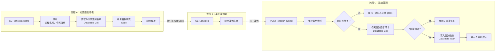

# Webhook 實作
## 範例 2：全班 QR Code 簽到（全班一起動手）

### 📚 工作流程說明

上課第一件事：老師把「簽到看板」投影在教室前面，全班拿出手機掃 QR Code、輸入學號姓名、按下簽到，**投影幕上的名單就一個一個跳出來**。

這個範例用 3 個 Webhook 組成一個完整的小系統：

| 網址 | 誰在用 | 做什麼 |
| :--- | :--- | :--- |
| `GET /webhook/checkin-board` | 老師（投影） | 顯示 QR Code 與今天的簽到名單，每 5 秒自動更新 |
| `GET /webhook/checkin` | 學生（手機掃碼） | 顯示簽到表單 |
| `POST /webhook/checkin-submit` | 學生按下「簽到」 | 檢查資料、防止重複簽到、寫入 DataTable、回傳結果頁 |

> 🎓 **上課建議**：先讓全班當「使用者」掃碼簽到，感受一下這個系統；再打開工作流，一個節點一個節點拆解它是怎麼做到的。

---

### 流程架構圖



---

### 工作流程樣版下載

- [📥 全班 QR Code 簽到 (全班QRCode簽到.json)](./全班QRCode簽到.json)

---

### 📋 節點詳細說明

#### 流程 A：老師簽到看板

1. **老師簽到看板（Webhook）**：GET，Path `checkin-board`
2. **設定（Set）**：`class_name`（課程名稱，顯示在看板標題）、`today`（`$now.toFormat('yyyy-MM-dd')`）
3. **讀取今天的簽到名單（DataTable：Get Row(s)）**
   - **Data Table**：By Name `簽到紀錄`
   - **Filter**：`class_date` Equals `{{ $json.today }}`
   - **Return All**：開啟；**Order By**：`createdAt` 由舊到新
   - ⚙️ **Settings ➔ Always Output Data**：開啟（還沒有人簽到時，流程才不會停住）
4. **產生看板網頁（Code）**
   - 從請求的 Header（`host`、`x-forwarded-proto`）自動組出簽到網址，例如 `https://xxxx.ngrok-free.app/webhook/checkin`，不用手動填網址
   - 用免費的 QuickChart 服務產生 QR Code 圖片：`https://quickchart.io/qr?text=簽到網址`
   - `<meta http-equiv="refresh" content="5">`：網頁每 5 秒自動重新整理，名單就會即時更新
5. **顯示看板（Respond to Webhook）**：Text + `Content-Type: text/html`

#### 流程 B：學生簽到頁

6. **學生簽到頁（Webhook）**：GET，Path `checkin`
7. **顯示簽到表單（Respond to Webhook）**
   - 一段固定的 HTML：`<form method="post" action="/webhook/checkin-submit">`
   - 用 `localStorage` 記住上次輸入的學號姓名，下次簽到不用再打字

#### 流程 C：送出簽到

8. **接收簽到資料（Webhook）**：POST，Path `checkin-submit`
   - HTML 表單送出的資料在 `$json.body`，欄位名稱就是 `<input name="...">`
9. **整理簽到資料（Set）**
   - `student_id`：去空白、轉大寫（`b112` 和 `B112 ` 視為同一人）
   - `safe_name`：HTML 跳脫後的姓名（放進結果頁用，原因見範例 1）
   - `class_date`、`checkin_time`：今天日期與目前時間
10. **資料完整嗎？（IF）**：學號、姓名都不是空的；否則回傳 400 頁面
11. **今天簽到過了嗎？（DataTable：Get Row(s)）**
    - Filter：`class_date` = 今天 **且** `student_id` = 學號，Limit 1
    - ⚙️ Always Output Data：開啟
12. **已經簽到過？（IF）**：`{{ $json.id }}` exists（有查到資料列）
13. **寫入簽到紀錄（DataTable：Insert）**：`class_date`、`checkin_time`、`student_id`、`name`
14. **顯示：簽到成功／重複簽到／資料不完整（Respond to Webhook）**

---

### ⚙️ 使用前準備

1. **建立 DataTable**：n8n 左側選單 **Data tables** ➔ **Create table**，名稱 `簽到紀錄`，新增 4 個欄位（型別都選 **String**）：

   | 欄位 | 說明 |
   | :--- | :--- |
   | `class_date` | 上課日期，例如 `2026-11-20` |
   | `checkin_time` | 簽到時間，例如 `09:01:32` |
   | `student_id` | 學號 |
   | `name` | 姓名 |

   DataTable 會自動加上 `id`、`createdAt`、`updatedAt` 欄位，不用自己建。

2. **準備學生手機連得到的網址**：學生的手機不在你的電腦上，`localhost` 是連不到的。三選一：
   - [ngrok](../../ngrok安裝/)：最快，一行指令產生 `https://xxxx.ngrok-free.app`
   - [Cloudflare Tunnel](../../cloudflare_tunnel/)：可以用自己的網域
   - n8n Cloud：本來就有公開網址

   ⚠️ 用 ngrok 時，請**從 ngrok 網址打開老師看板**（不是 localhost），QR Code 裡的網址才會是學生連得到的網址。
   ⚠️ ngrok 免費版第一次用瀏覽器打開時，會先出現一個警告頁面，請學生按 **Visit Site** 繼續即可。

3. **匯入工作流**：匯入 [`全班QRCode簽到.json`](./全班QRCode簽到.json)，「設定」節點可以改課程名稱。
4. **切換為 Active**。
5. **投影老師看板**：`https://你的網址/webhook/checkin-board`
6. **全班掃碼簽到**，看名單即時跳出來。

---

### 🧪 試試看這些狀況

| 動作 | 預期結果 |
| :--- | :--- |
| 正常簽到 | 🎉 簽到成功，看板人數 +1 |
| 同一個學號再簽一次 | 😉 你今天已經簽到過了（顯示第一次的時間） |
| 學號輸入小寫或前後有空白 | 自動轉成大寫、去掉空白，仍判斷為同一人 |
| 姓名輸入 `<b>小明</b>` | 看板上顯示原始文字，不會變成粗體（HTML 跳脫） |
| 隔天再打開看板 | 名單從 0 開始（依 `class_date` 篩選） |

---

### 🎯 學習重點

- **一個系統 = 多個 Webhook**：GET 顯示頁面、POST 接收資料
- **Respond to Webhook 回傳 HTML**，n8n 就是網頁伺服器
- **DataTable 讀寫**：Get（篩選、排序）與 Insert，資料不會因為工作流結束而消失
- **防止重複**：寫入前先查詢
- **Always Output Data**：處理「查無資料」的情況
- **從 Request Header 取得網址**：`host`、`x-forwarded-proto`
- **為什麼一定要 Active**：網頁呼叫的都是 Production URL

---

<details>
<summary>🤖 <strong>AI 賦能延伸實作（附 Prompt 提詞）</strong></summary>

> 💡 **任務目標**：限制只有名單上的學生可以簽到、超過上課時間標記為遲到，並在下課時寄出缺席名單。

**可直接複製給 AI 的 Prompt 提詞**：
```text
請幫我擴充「全班 QR Code 簽到」工作流程：
1. 我會先建立 DataTable「學生名單」（欄位 student_id、name、email）。
2. 在「資料完整嗎？」之後，用 DataTable Get 查詢學生名單中是否有這個 student_id；
   沒有的話回傳「查無此學號，請確認是否輸入正確」的 HTML 頁面（狀態碼 404）。
3. 在「設定」節點加上 start_time（例如 09:10），簽到時間晚於 start_time 時，
   寫入簽到紀錄時多一個欄位 status = "遲到"，否則為 "準時"；看板上遲到的同學用橘色顯示。
4. 新增 Schedule Trigger（每天 12:00），比對學生名單與今天的簽到紀錄，
   找出沒有簽到的同學，用 Gmail 寄出「今日缺席名單」給老師（收件人先填 YOUR_EMAIL@gmail.com）。
請幫我建立節點、設定篩選條件並完成連線！
```
</details>
