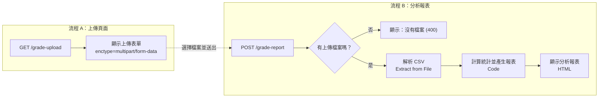

# Webhook 實作
## 範例 4：網頁上傳成績單報表（檔案上傳與自動分析）

### 📚 工作流程說明

老師期中考後拿到一份 CSV 成績單，想知道：各科平均幾分？及格率多少？前五名是誰？誰需要補救教學？

這個範例做一個「成績分析網頁」：打開網址、選擇 CSV 檔案、按下分析，n8n 就回傳一份排版好的分析報表。**不用 curl、不用寫程式**，可以直接拿自己班上的成績單來試。

Code 節點會**自動判斷**哪一欄是姓名、哪些欄是科目（全部是數字的欄位，並排除學號、座號），所以不管 CSV 有幾個科目、欄位叫什麼名字都能分析。

---

### 流程架構圖



---

### 工作流程樣版下載

- [📥 網頁上傳成績單報表 (網頁上傳成績單報表.json)](./網頁上傳成績單報表.json)
- [📄 範例成績單 (學生成績單.csv)](./學生成績單.csv)：50 位學生的國文、英文、數學成績

---

### 📋 節點詳細說明

#### 流程 A：上傳頁面

1. **開啟上傳頁面（Webhook）**：GET，Path `grade-upload`
2. **顯示上傳表單（Respond to Webhook）**
   - 上傳檔案的表單有兩個重點：
     ```html
     <form method="post" action="/webhook/grade-report" enctype="multipart/form-data">
       <input type="file" name="file" accept=".csv">
     ```
   - `enctype="multipart/form-data"`：**沒有這個屬性，瀏覽器只會送出檔名，不會送出檔案內容**
   - `accept=".csv"`：選檔視窗只顯示 CSV 檔

#### 流程 B：分析報表

3. **接收成績單檔案（Webhook）**：POST，Path `grade-report`
   - 上傳的檔案會出現在節點輸出的 **Binary** 分頁，而不是 JSON 分頁
4. **有上傳檔案嗎？（IF）**：`{{ Object.keys($binary || {}).length }}` 大於 0
   - `$binary` 是這筆資料附帶的所有檔案
5. **解析 CSV（Extract from File：Extract From CSV）**
   - **Input Binary Field**：`={{ Object.keys($binary)[0] }}`（自動抓第一個檔案，不用管欄位叫什麼名字）
   - 每一列變成一筆資料，第一列當欄位名稱
6. **計算統計並產生報表（Code）**
   - **自動找欄位**：不是數字的欄位 ➔ 姓名；全部是數字、而且名稱不像「學號／座號／編號」的欄位 ➔ 科目
   - **各科統計**：平均、最高、最低、及格率（≥ 60 分）
   - **學生排名**：總分由高到低取前五名
   - **補救名單**：任一科低於 60 分的學生，列出不及格科目
   - 及格率用 `<div style="width:XX%">` 畫成長條圖
7. **顯示分析報表（Respond to Webhook）**：Text + `Content-Type: text/html`

---

### ⚙️ 使用前準備

1. **匯入工作流**：匯入 [`網頁上傳成績單報表.json`](./網頁上傳成績單報表.json)，切換為 **Active**。
2. **打開上傳頁面**：`https://你的網址/webhook/grade-upload`
3. **上傳** [`學生成績單.csv`](./學生成績單.csv)，按下「開始分析」。
4. **換自己的資料試試**：用 Excel 開一份成績單，**另存新檔 ➔ CSV UTF-8（逗號分隔）**，再上傳一次。

> ⚠️ **中文變亂碼？** Excel 預設存成的「CSV（逗號分隔）」在 Windows 上是 Big5 編碼，n8n 會讀成亂碼。請選擇 **CSV UTF-8**。

---

### 🧪 試試看這些狀況

| 動作 | 預期結果 |
| :--- | :--- |
| 上傳範例成績單 | 50 位學生、3 個科目的完整報表 |
| 在 CSV 加一欄「自然」 | 報表自動多出「自然」這一科 |
| 把某位同學的數學改成 45 | 他出現在「需要補救教學」名單 |
| 上傳一份沒有數字欄位的 CSV | 顯示「找不到成績欄位」 |
| 不選檔案直接送出（用 F12 拿掉 required） | 400「沒有收到檔案」 |

---

### 🎯 學習重點

- **Webhook 接收檔案**：`multipart/form-data` 與 Binary 資料
- **`$binary`**：取得上傳的檔案
- **Extract from File**：CSV ➔ JSON
- **Code 節點做資料分析**：平均、極值、比例、排序、篩選
- **動態判斷欄位**：寫出能處理不同格式資料的流程
- **回傳 HTML 報表**

---

<details>
<summary>🤖 <strong>AI 賦能延伸實作（附 Prompt 提詞）</strong></summary>

> 💡 **任務目標**：報表下方加上 AI 寫的班級學習分析，並提供 Excel 下載。

**可直接複製給 AI 的 Prompt 提詞**：
```text
請幫我擴充「網頁上傳成績單報表」工作流程：
1. 在「計算統計並產生報表」的 Code 節點中，另外輸出一個 stats 物件（各科平均、及格率、前五名、補救名單）。
2. 新增 Basic LLM Chain 節點，連接 Google Gemini Chat Model（models/gemini-2.5-flash），
   以導師的角度根據 stats 寫一段 150 字以內的班級學習分析與教學建議（繁體中文）。
3. 把 AI 分析放在報表最下方「🤖 AI 學習分析」區塊。
4. 新增第二個 Webhook（GET /grade-report-excel）的做法說明，或改為在報表中提供「下載含總分與排名的 Excel」按鈕：
   用 Convert to File 節點產生 xlsx，透過 Respond to Webhook（Respond With: Binary File）回傳下載。
請幫我建立節點、撰寫程式碼並完成連線！
```
</details>
