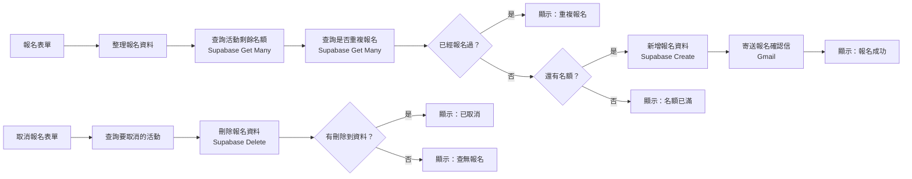

# 範例 01：社團活動報名系統

社團辦活動最怕什麼？名額爆掉、同一個人報兩次、報名完不知道有沒有成功。本範例用 **n8n 表單 + Supabase** 做出一套會自己檢查名額的報名系統：學生填表單，系統即時查詢剩餘名額，有名額才寫入資料庫並寄出確認信，額滿或重複報名都會直接在網頁上告訴學生。

全程使用 **Supabase 節點**，用下拉選單操作資料表，**完全不用寫 SQL**。

### 🎯 本範例功能

- ✅ **網頁報名表單**：姓名、學號、Email、系級、活動下拉選單
- ✅ **即時名額檢查**：讀取 View `club_activity_seats`，自動算出剩餘名額
- ✅ **防止重複報名**：同一個 Email 報名同一個活動會被擋下
- ✅ **寄送確認信**：報名成功自動寄出 HTML 確認信
- ✅ **取消報名**：第二個表單可以刪除報名資料，名額立刻釋出
- ✅ **表單結果頁**：成功、額滿、重複、查無資料各有不同的回應畫面

---

## 🗂️ 資料表設計

執行 [`setup.sql`](./setup.sql) 後會建立：

| 名稱 | 類型 | 說明 |
| :--- | :--- | :--- |
| `club_activities` | 資料表 | 5 個活動：名稱、主辦社團、日期、地點、名額、報名費 |
| `club_registrations` | 資料表 | 報名紀錄，`(activity_id, email)` 設為 UNIQUE 防重複 |
| `club_activity_seats` | 檢視表 (View) | 自動計算每個活動的「已報名人數」與「剩餘名額」 |

預先準備好的測試狀況：

| 活動 | 名額 | 已報名 | 剩餘 | 用途 |
| :--- | :---: | :---: | :---: | :--- |
| 陽明山夜衝看星星 | 20 | 3 | 17 | 正常報名 |
| 手沖咖啡入門體驗 | 12 | 11 | **1** | 只剩最後一位，報名一次後就額滿 |
| 街舞基礎 Breaking 課 | 25 | 2 | 23 | 正常報名 |
| 桌遊之夜：狼人殺大會 | 10 | 10 | **0** | 測試「名額已滿」 |
| 淨灘志工：八里海岸 | 40 | 0 | 40 | 正常報名 |

> 💡 **為什麼要用 View？** 剩餘名額 = 名額 − 報名人數，每次有人報名或取消都會變動。用 View 讓資料庫即時計算，n8n 只要「讀取」就好，不用自己數。

---

## 🚀 工作流程架構

### 節點說明

#### 1. **報名表單**（n8n Form Trigger）
- **欄位**：姓名、學號、Email（email 類型）、系級、報名活動（下拉選單）
- 下拉選單的選項必須和 `club_activities.title` **一字不差**，因為下一步要用活動名稱查資料。

#### 2. **整理報名資料**（Edit Fields / Set）
把表單的中文欄位整理成英文欄位，順便清理資料：
- `email`：`={{ $json['Email'].trim().toLowerCase() }}`（去空白、轉小寫，避免 `Amy@x.com` 和 `amy@x.com` 被當成兩個人）
- `student_id`：`={{ $json['學號'].trim().toUpperCase() }}`

#### 3. **查詢活動剩餘名額**（Supabase：Get Many）
- **Table**：`club_activity_seats`（View 也可以直接選）
- **Filter**：`title` **Equals** `={{ $json.activity_title }}`
- 輸出：`id`、`title`、`capacity`、`registered`、`remaining`…

#### 4. **查詢是否重複報名**（Supabase：Get Many）
- **Table**：`club_registrations`
- **Filters**（All Select Conditions）：`activity_id` = 活動 id，且 `email` = 報名者 Email
- ⚙️ **Settings ➔ Always Output Data：開啟**。查不到資料時 Supabase 節點預設不輸出任何東西，流程就會停住；開啟後會輸出一筆空資料，讓下一個 IF 能判斷「沒有重複」。

#### 5. **已經報名過？**（IF）
- 條件：`{{ $json.id }}` **exists**（有查到報名紀錄 = 重複報名）

#### 6. **還有名額？**（IF）
- 條件：`{{ $('查詢活動剩餘名額').first().json.remaining }}` **>** `0`
- `$('節點名稱')` 可以取得**前面任何一個節點**的資料，不限於上一個節點。

#### 7. **新增報名資料**（Supabase：Create）
- **Table**：`club_registrations`
- **Fields**：`activity_id`、`student_name`、`student_id`、`email`、`department`

#### 8. **寄送報名確認信**（Gmail：Send）
- **To**：報名者 Email
- **Email Type**：HTML，信中帶入活動名稱、日期、地點、報名費與報名順位

#### 9. **顯示：報名成功／名額已滿／重複報名**（n8n Form：Form Ending）
- 表單送出後顯示的結果頁。工作流中有 Form 節點時，表單會等流程跑到 Form Ending 才顯示結果。

#### 10. **取消報名流程**
- **查詢要取消的活動**（Supabase Get Many）取得活動 id
- **刪除報名資料**（Supabase Delete）：條件為 `activity_id` + `email`，同樣開啟 **Always Output Data**
- **有刪除到資料？**（IF）：Supabase Delete 會回傳被刪掉的資料，有 `id` 代表刪除成功

---

## 📸 工作流程圖

<!-- 截圖請放在 ./images/社團活動報名系統.png -->

---

## ⚙️ 使用前準備

1. **建立 Supabase 專案與憑證**：依照 [Supabase 設定指南](../Supabase設定/README.md) 建立 **Supabase API** 憑證。
2. **建立資料表**：Supabase ➔ **SQL Editor**，貼上 [`setup.sql`](./setup.sql) 全部內容並執行。
3. **建立 Gmail 憑證**：參考 [Gemini 與 Gmail 憑證設定](../Gemini與Gmail憑證/README.md)。
4. **匯入工作流**：n8n 右上角 **⋯** ➔ **Import from File**，選擇 [`社團活動報名系統.json`](./社團活動報名系統.json)。
5. **選擇憑證**：打開每個 Supabase 節點選 **Supabase API**、Gmail 節點選 **Gmail**。
6. **測試**：
   - 點兩下「報名表單」節點 ➔ **Test step**，會開啟表單網頁。
   - 用**自己的 Email** 報名「陽明山夜衝看星星」➔ 應該看到成功頁並收到確認信。
   - 再用同一個 Email 報名同一個活動 ➔ 應該看到「您已經報名過囉」。
   - 報名「桌遊之夜：狼人殺大會」➔ 應該看到「名額已滿」。
   - 到 Supabase **Table Editor** 查看 `club_registrations` 是否多了一筆。
7. **正式啟用**：工作流右上角切換為 **Active**，使用 **Production URL** 分享給同學。

> 🔄 資料玩亂了？重新執行一次 `setup.sql` 就會恢復初始狀態。

---

## 📥 相關檔案下載

- [🚀 下載完整工作流 (JSON)](./社團活動報名系統.json)
- [📜 建表與測試資料 (setup.sql)](./setup.sql)

---

**💡 進階應用**：
- 額滿時改為加入「候補名單」資料表，有人取消時自動通知第一位候補者
- 活動前一天用 Schedule Trigger 寄出行前提醒信給所有報名者
- 用 Supabase **Update** 節點加上「報到」功能，活動當天掃描 QR Code 更新報到狀態
