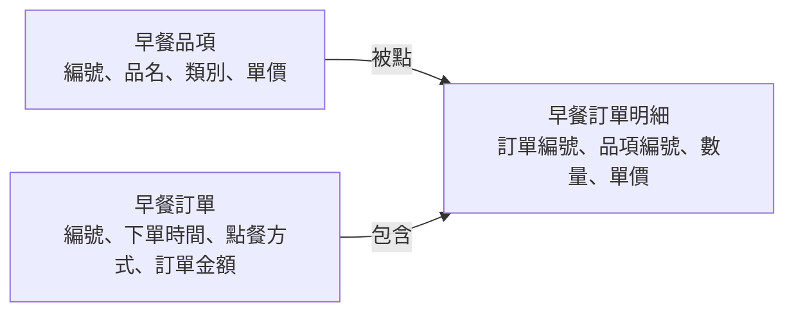
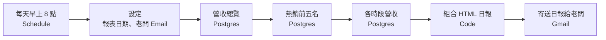

# 範例 02：早餐店每日營收日報

早餐店老闆每天收攤後最想知道：「昨天賺多少？什麼最好賣？幾點最忙？」本範例讓 n8n 每天早上 8 點自動到 Supabase 撈出昨天的訂單，用 SQL 算好營收、熱銷排行和時段分布，整理成一封漂亮的 HTML 日報寄到老闆信箱。

這是第一個使用 **Postgres 節點寫 SQL** 的範例，會用到 `JOIN`、`GROUP BY`、`COUNT`、`SUM` 這些在資料分析中最常用的語法。

### 🎯 本範例功能

- ✅ **自動產生 1,700 筆訂單**：`setup.sql` 用 `generate_series` + `random()` 產生最近 30 天、有尖峰離峰的擬真資料
- ✅ **排程觸發**：每天早上 8 點自動執行
- ✅ **三段 SQL 統計**：營收總覽（含與上週同日比較）、熱銷前五名、各時段營收
- ✅ **參數化查詢**：日期用 `$1` 傳入，避免 SQL Injection
- ✅ **HTML 郵件報表**：數字卡片、排行榜、用 `<div>` 畫的長條圖

---

## ⚙️ 使用前準備

1. **建立 Postgres 憑證**：依照 [Supabase 設定指南](../Supabase設定/README.md) 建立 **Supabase Postgres** 憑證。
2. **產生測試資料**：Supabase ➔ **SQL Editor**，執行 [`setup.sql`](./setup.sql)。最後會顯示最近 7 天的營收。
3. **匯入工作流**：匯入 [`早餐店每日營收日報.json`](./早餐店每日營收日報.json)。
4. **選擇憑證**：三個 Postgres 節點選 **Supabase Postgres**，Gmail 節點選 **Gmail**。
5. **修改設定**：「設定」節點的 `老闆信箱` 改成自己的 Email。
6. **測試**：按 **Execute workflow**，到信箱查看日報。
7. **正式啟用**：切換為 **Active**，之後每天早上 8 點自動寄出。

> 🔄 **資料是以「執行 setup.sql 那天」往回產生 30 天**。過了幾週再上課，昨天可能已經沒有資料，重新執行一次 `setup.sql` 即可。

---

## 🗂️ 資料表設計



| 資料表 | 說明 | 筆數 |
| :--- | :--- | :--- |
| `早餐品項` | 菜單：漢堡、蛋餅、吐司、點心、飲料共 20 項 | 20 |
| `早餐訂單` | 一張單：下單時間、點餐方式（內用／外帶／外送平台）、訂單金額 | 約 1,700 |
| `早餐訂單明細` | 一張單點了哪些餐、幾份 | 約 4,800 |

**`早餐品項`**：`編號`（主鍵）、`品名`、`類別`、`單價`、`熱門權重`（產生假資料用，數字越大越常被點）

**`早餐訂單`**：`編號`（主鍵）、`下單時間`（TIMESTAMP）、`點餐方式`、`訂單金額`

**`早餐訂單明細`**：`編號`（主鍵）、`訂單編號`（對應 `早餐訂單.編號`）、`品項編號`（對應 `早餐品項.編號`）、`數量`、`單價`

> 💡 **為什麼要拆成兩張表？** 一張訂單可能點了「蛋餅 + 奶茶 + 薯餅」。如果全部塞在同一列，就沒辦法統計「薯餅總共賣了幾份」。把明細拆出來，用 `JOIN` 再組回去，是關聯式資料庫最核心的設計觀念。

---

## 🚀 工作流程架構



### 節點說明

#### 1. **每天早上 8 點**（Schedule Trigger）
- **Trigger Interval**：Days，**Hour**：8
- 工作流設定的時區為 `Asia/Taipei`。

#### 2. **設定**（Edit Fields / Set）
| 欄位 | 值 | 說明 |
| :--- | :--- | :--- |
| `報表日期` | `={{ $now.minus({ days: 1 }).toFormat('yyyy-MM-dd') }}` | 昨天的日期。想看其他天，直接改成例如 `2026-11-15` |
| `老闆信箱` | `YOUR_EMAIL@gmail.com` | ⚠️ 改成你的 Email |
| `店名` | `阿嬤的早餐店` | 顯示在信件標題 |

#### 3. **營收總覽**（Postgres：Execute Query）
```sql
SELECT
  COUNT(*)                                     AS 訂單數,
  COALESCE(SUM(訂單金額), 0)                   AS 營收,
  COALESCE(ROUND(AVG(訂單金額)), 0)            AS 客單價,
  COUNT(*) FILTER (WHERE 點餐方式 = '外送平台') AS 外送單數,
  (SELECT COALESCE(SUM(訂單金額), 0)
     FROM 早餐訂單
    WHERE 下單時間::date = $1::date - 7)       AS 上週同日營收
FROM 早餐訂單
WHERE 下單時間::date = $1::date;
```
- **Options ➔ Query Parameters**：`={{ $json.報表日期 }}`，對應 SQL 裡的 `$1`
- `下單時間::date`：把「日期 + 時間」轉成只有日期，才能和 `2026-11-19` 比較
- `COUNT(*) FILTER (WHERE ...)`：只計算符合條件的列，一次算出多種統計

> ⚠️ **為什麼不直接把日期寫進 SQL？** 如果寫成 `WHERE 下單時間::date = '{{ $json.報表日期 }}'`，日期內容會直接拼進 SQL 字串，萬一來源是使用者輸入，就可能被塞入惡意指令（SQL Injection）。使用 `$1` 參數，資料庫會把它當成「值」而不是「指令」。

#### 4. **熱銷前五名**（Postgres：Execute Query）
```sql
SELECT m.品名, m.類別,
       SUM(i.數量)          AS 份數,
       SUM(i.數量 * i.單價) AS 銷售額
FROM 早餐訂單明細 i
JOIN 早餐訂單 o ON o.編號 = i.訂單編號
JOIN 早餐品項 m ON m.編號 = i.品項編號
WHERE o.下單時間::date = $1::date
GROUP BY m.品名, m.類別
ORDER BY 份數 DESC
LIMIT 5;
```
- 三張表 `JOIN` 在一起：明細 ➔ 訂單（取得日期）➔ 品項（取得品名）
- SQL 裡的 `AS 份數`：替計算結果取一個中文名稱，n8n 輸出的欄位就叫 `份數`
- **Query Parameters**：`={{ $('設定').first().json.報表日期 }}`
- ⚙️ **Settings ➔ Execute Once：開啟**。上一個節點只輸出 1 筆，但習慣上開啟可避免上游有多筆資料時重複查詢。

#### 5. **各時段營收**（Postgres：Execute Query）
```sql
SELECT EXTRACT(HOUR FROM 下單時間)::int AS 時段,
       COUNT(*)      AS 訂單數,
       SUM(訂單金額) AS 營收
FROM 早餐訂單
WHERE 下單時間::date = $1::date
GROUP BY 1
ORDER BY 1;
```
- `EXTRACT(HOUR FROM ...)`：取出「幾點」，依小時分組
- ⚙️ **Execute Once：開啟**（上一個節點輸出 5 筆，不開啟的話會查 5 次）

#### 6. **組合 HTML 日報**（Code）
- 用 `$('營收總覽').first().json`、`$('熱銷前五名').all()` 取得三個查詢的結果
- 計算與上週同日的漲跌百分比（▲ 綠色／▼ 紅色）
- 長條圖：Email 不能執行 JavaScript，所以用 `<div style="width:XX%">` 的寬度畫出長條
- 輸出 `to`、`subject`、`html` 三個欄位

#### 7. **寄送日報給老闆**（Gmail：Send）
- **To**：`={{ $json.to }}`，**Subject**：`={{ $json.subject }}`
- **Email Type**：HTML，**Message**：`={{ $json.html }}`

---

## 📸 工作流程圖

<!-- 截圖請放在 ./images/早餐店每日營收日報.png -->

---

## 📥 相關檔案下載

- [🚀 下載完整工作流 (JSON)](./早餐店每日營收日報.json)
- [📜 建表與測試資料 (setup.sql)](./setup.sql)

---

**💡 進階應用**：
- 每週一寄出「週報」：改成統計最近 7 天，並比較上上週
- 把 SQL 結果交給 Gemini，讓 AI 寫一段「今日營運建議」（例如：週末蛋餅賣得特別好，建議多備料）
- 用 Supabase 建立 `早餐每日統計` 資料表，每天把統計結果存起來，累積成歷史趨勢
