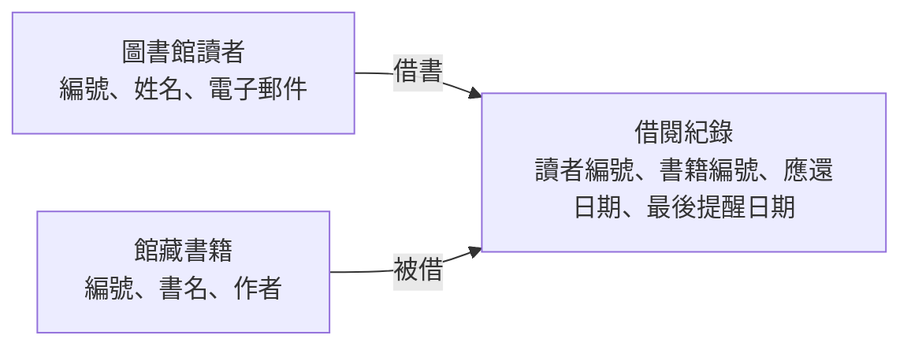
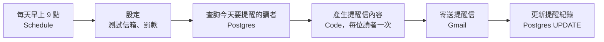

# 範例 03：圖書館逾期還書提醒

圖書館每天都有人忘記還書，館員一個一個打電話太累了。本範例讓 n8n 每天早上自動找出逾期未還的讀者，**一位讀者寄一封信**列出他所有逾期的書與罰款，並依照逾期天數自動調整語氣（溫馨提醒 ➔ 再次提醒 ➔ 最後通知）。

最重要的觀念是**「防止重複寄信」**：寄完信後把日期寫回資料庫，就算工作流不小心執行兩次，同一天也不會寄出第二封。

### 🎯 本範例功能

- ✅ **找出該提醒的人**：未歸還 + 已過到期日 + 今天還沒提醒過
- ✅ **一人一封信**：用 `GROUP BY` + `json_agg` 把同一位讀者的多本書合併
- ✅ **語氣分級**：依最久逾期天數決定信件標題與顏色
- ✅ **自動計算罰款**：每本每天 5 元
- ✅ **回寫狀態**：寄出後更新 `最後提醒日期` 與 `提醒次數`
- ✅ **測試模式**：所有信件可先寄到自己的信箱

---

## ⚙️ 使用前準備

1. **建立 Postgres 憑證**：依照 [Supabase 設定指南](../Supabase設定/README.md)。
2. **產生測試資料**：Supabase ➔ **SQL Editor**，執行 [`setup.sql`](./setup.sql)，最後會列出 11 筆今天該提醒的借閱。
3. **匯入工作流**：匯入 [`圖書館逾期還書提醒.json`](./圖書館逾期還書提醒.json)，選擇 Postgres 與 Gmail 憑證。
4. **修改設定**：「設定」節點的 `測試信箱` 改成自己的 Email。
5. **測試**：
   - 按 **Execute workflow** ➔ 信箱應收到 **9 封**提醒信，徐靜宜那封列出 3 本書。
   - 再按一次 **Execute workflow** ➔ 「查詢今天要提醒的讀者」應該沒有輸出，**不會再寄信**。
   - 到 Supabase 執行 `SELECT * FROM 借閱紀錄 ORDER BY 編號;` 看 `最後提醒日期` 與 `提醒次數` 的變化。

> 🔄 想重新測試？重新執行 `setup.sql` 即可。
> 🕘 **時區小提醒**：Supabase 資料庫預設是 UTC 時間，本範例已在 `setup.sql` 與兩個 Postgres 節點的 SQL 開頭都加上 `SET TIME ZONE 'Asia/Taipei';`，確保無論幾點上課執行，兩邊的 `CURRENT_DATE` 永遠都是台灣時間的今天。

---

## 🗂️ 資料表設計

| 資料表 | 說明 | 筆數 |
| :--- | :--- | :--- |
| `圖書館讀者` | `編號`、`姓名`、`電子郵件`、`電話`、`讀者類型`（一般讀者／學生／樂齡） | 30 |
| `館藏書籍` | `編號`、`書名`、`作者`、`分類`、`條碼` | 30 |
| `借閱紀錄` | `編號`、`讀者編號`、`書籍編號`、`借出日期`、`應還日期`、`歸還日期`（空白＝還沒還）、**`最後提醒日期`**、`提醒次數` | 23 |



`setup.sql` 以「今天」為基準刻意安排了各種狀況，方便驗證 SQL 條件寫得對不對：

| 狀況 | 筆數 | 應該寄信嗎？ |
| :--- | :---: | :---: |
| 已歸還 | 5 | ❌ |
| 借閱中、還沒到期（含今天到期） | 6 | ❌ |
| 逾期 1～3 天，從未提醒 | 3 | ✅ 溫馨提醒 |
| 逾期 7～14 天，之前提醒過（不是今天） | 3 | ✅ 再次提醒 |
| 逾期 8 天，**今天已經提醒過** | 1 | ❌ |
| 逾期 30 天以上 | 2 | ✅ 最後通知 |
| 同一位讀者 3 本書都逾期 5 天 | 3 | ✅ 合併成 1 封 |

**正確結果：11 本書、9 位讀者，寄出 9 封信。** 執行第二次應該是 0 封。

---

## 🚀 工作流程架構



### 節點說明

#### 1. **每天早上 9 點**（Schedule Trigger）

#### 2. **設定**（Edit Fields / Set）
| 欄位 | 值 | 說明 |
| :--- | :--- | :--- |
| `測試信箱` | `YOUR_EMAIL@gmail.com` | ⚠️ 改成你的 Email。**有填就寄給自己，清空才會寄給讀者本人** |
| `圖書館名稱` | `星光市立圖書館` | |
| `每日罰款` | `5` | 每本書每天罰款 |

#### 3. **查詢今天要提醒的讀者**（Postgres：Execute Query）
```sql
SET TIME ZONE 'Asia/Taipei';

SELECT
  m.編號 AS 讀者編號,
  m.姓名,
  m.電子郵件,
  json_agg(json_build_object(
    '書名',     b.書名,
    '應還日期', to_char(l.應還日期, 'YYYY-MM-DD'),
    '逾期天數', CURRENT_DATE - l.應還日期
  ) ORDER BY l.應還日期)          AS 逾期書單,
  MAX(CURRENT_DATE - l.應還日期)  AS 最多逾期天數,
  SUM(CURRENT_DATE - l.應還日期)  AS 累計逾期天數
FROM 借閱紀錄 l
JOIN 圖書館讀者 m ON m.編號 = l.讀者編號
JOIN 館藏書籍   b ON b.編號 = l.書籍編號
WHERE l.歸還日期 IS NULL                     -- 還沒還
  AND l.應還日期 < CURRENT_DATE              -- 已經過了應還日期
  AND (l.最後提醒日期 IS NULL
       OR l.最後提醒日期 < CURRENT_DATE)     -- 今天還沒寄過
GROUP BY m.編號, m.姓名, m.電子郵件
ORDER BY 最多逾期天數 DESC;
```
- **日期相減**：`CURRENT_DATE - l.應還日期` 在 PostgreSQL 直接得到相差天數
- **`json_agg`**：把同一組（同一位讀者）的多列合併成一個 JSON 陣列，n8n 收到的 `逾期書單` 就是陣列，可以直接用 `.map()` 處理
- **`IS NULL`**：判斷空值不能用 `= NULL`，一定要用 `IS NULL`

#### 4. **產生提醒信內容**（Code）
- **Mode**：`Run Once for Each Item`（每位讀者執行一次）
- 依 `最多逾期天數` 分級：

| 最久逾期 | 標題 | 顏色 |
| :--- | :--- | :--- |
| 1～6 天 | 溫馨提醒 | 藍 |
| 7～29 天 | 再次提醒 | 橘 |
| 30 天以上 | 最後通知（7 天內未還將停權） | 紅 |

- 收件人：`cfg.測試信箱 || r.電子郵件`（有測試信箱就用測試信箱）

#### 5. **寄送提醒信**（Gmail：Send）
- 上一步有 9 筆資料，Gmail 節點會**自動執行 9 次**，不需要另外寫迴圈。

#### 6. **更新提醒紀錄**（Postgres：Execute Query）
```sql
SET TIME ZONE 'Asia/Taipei';

UPDATE 借閱紀錄
SET 最後提醒日期 = CURRENT_DATE,
    提醒次數     = 提醒次數 + 1
WHERE 讀者編號 = $1
  AND 歸還日期 IS NULL
  AND 應還日期 < CURRENT_DATE
  AND (最後提醒日期 IS NULL OR 最後提醒日期 < CURRENT_DATE)
RETURNING 編號, 讀者編號, 提醒次數;
```
- **Query Parameters**：`={{ $('產生提醒信內容').item.json.讀者編號 }}`
- `.item`：取得「和目前這筆配對」的資料。Gmail 寄出第 3 封信時，`.item` 就是第 3 位讀者。
- **只有寄信成功才會執行到這裡**；若 Gmail 失敗，這位讀者明天還會再被查出來。

---

## 📸 工作流程圖

<!-- 截圖請放在 ./images/圖書館逾期還書提醒.png -->

---

## 📥 相關檔案下載

- [🚀 下載完整工作流 (JSON)](./圖書館逾期還書提醒.json)
- [📜 建表與測試資料 (setup.sql)](./setup.sql)

---

**💡 進階應用**：
- 逾期超過 30 天的讀者，另外寄一份彙整清單給館員
- 到期前 2 天先寄「即將到期」提醒（條件改成 `應還日期 = CURRENT_DATE + 2`）
- 在信中加入「一鍵續借」連結，連到 n8n Webhook，更新 `應還日期` 延長 14 天
