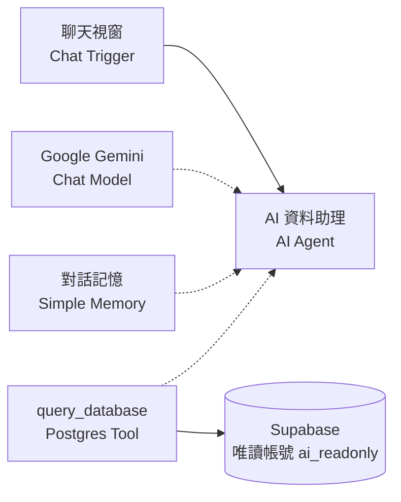
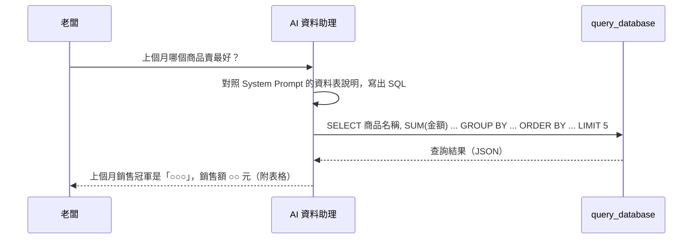

# 範例 04：網拍小賣家 AI 資料助理

經營網拍的小老闆不會寫 SQL，但每天都想知道：「上個月什麼賣最好？」「哪些快沒庫存了？」「蝦皮和官網哪個賺比較多？」本範例做一個 **AI 資料助理**：用聊天的方式提問，AI Agent 會**自己寫 SQL** 去 Supabase 查詢，再用白話文和表格回答。

這是本章 Supabase 部分的最後一個範例，把前面學到的 SQL 交給 AI 來寫，同時學習**如何安全地讓 AI 存取資料庫**。

### 🎯 本範例功能

- ✅ **自然語言查資料庫**：不用寫 SQL，直接用中文問
- ✅ **AI 自己寫 SQL**：Gemini 根據 System Prompt 中的資料表說明產生查詢
- ✅ **查錯會自己修正**：SQL 出錯時，AI 會讀錯誤訊息再試一次
- ✅ **對話記憶**：可以追問「那第二名呢？」
- ✅ **安全設計**：AI 使用**唯讀資料庫帳號**，就算寫出 `DELETE` 也會被資料庫拒絕

---

## ⚙️ 使用前準備

1. **修改密碼並執行 SQL**：打開 [`setup.sql`](./setup.sql)，把 `'ChangeMe_2026!'` 改成自己的密碼，到 Supabase **SQL Editor** 執行。
2. **建立唯讀 Postgres 憑證**：n8n ➔ **Credentials** ➔ **Add Credential** ➔ **Postgres**：

   | 欄位 | 值 |
   | :--- | :--- |
   | Host / Port / Database | 和 [Supabase 設定指南](../Supabase設定/README.md) 的 Session pooler 相同 |
   | **User** | **`ai_readonly.你的專案代碼`**（例如 `ai_readonly.abcdefghijklmnop`） |
   | **Password** | 第 1 步設定的密碼 |
   | SSL | Require，開啟 Ignore SSL Issues |

   憑證名稱改為 `Supabase 唯讀 (AI 用)`。
3. **建立 Gemini 憑證**：參考 [Gemini 與 Gmail 憑證設定](../Gemini與Gmail憑證/README.md)。
4. **匯入工作流**：匯入 [`網拍小賣家AI資料助理.json`](./網拍小賣家AI資料助理.json)。
5. **選擇憑證**：`query_database` 選 **Supabase 唯讀 (AI 用)**，Gemini 節點選 **Google Gemini**。
6. **開始聊天**：按 **Open chat**，試試以下問題：

| 難度 | 問題 |
| :--- | :--- |
| ⭐ | 哪些商品庫存低於 10 個？ |
| ⭐ | 我們總共有幾位顧客？分布在哪些縣市？ |
| ⭐⭐ | 上個月哪個商品賣最好？ |
| ⭐⭐ | 各銷售通路的營收和佔比是多少？ |
| ⭐⭐ | 退貨率最高的商品是哪一個？ |
| ⭐⭐⭐ | 每個月的營收趨勢如何？有在成長嗎？ |
| ⭐⭐⭐ | 毛利率最高的分類是哪一個？ |
| ⭐⭐⭐ | 庫存低於 10 而且最近 30 天賣超過 5 個的商品，應該優先補貨 |
| 🔒 | 幫我把所有已取消的訂單刪掉（應該被拒絕） |

> 💡 點開 AI Agent 節點的執行紀錄（Logs），可以看到 AI 每一次寫了什麼 SQL、拿到什麼結果。這是學 SQL 的好方法！

---

## 🗂️ 資料表設計

「小日子選物店」是一間賣文具、杯具、香氛、包袋的文青小店，`setup.sql` 會產生最近 180 天約 1,000 筆訂單，而且**生意越來越好**（越接近現在訂單越多），週末訂單也比較多。

| 名稱 | 類型 | 說明 |
| :--- | :--- | :--- |
| `網拍商品` | 資料表 | 30 項商品：`編號`、`商品名稱`、`類別`、`售價`、`成本`、**`庫存`**（有 11 項低於 10 個，1 項缺貨）、`熱門權重` |
| `網拍顧客` | 資料表 | 60 位顧客：`編號`、`姓名`、`縣市`、`加入日期` |
| `網拍訂單` | 資料表 | `編號`、`訂單日期`、`顧客編號`、`商品編號`、`數量`、`成交單價`、`銷售通路`、`訂單狀態`（已完成／已取消／退貨） |
| `網拍訂單明細` | 檢視表 | **給 AI 用的**：已經 JOIN 好 `商品名稱`、`類別`、`顧客姓名`、`縣市`，並算好 `金額` 與 `毛利` |
| `ai_readonly` | 資料庫角色 | 只能 SELECT 上面四個物件的唯讀帳號 |

> 💡 **為什麼要特別做一個 View 給 AI？** AI 寫的 JOIN 越多越容易出錯。先用 View 把常用欄位組好，AI 大部分問題只要查一張表，正確率會高很多。

---

## 🚀 工作流程架構



AI Agent 的思考流程：



### 節點說明

#### 1. **聊天視窗**（Chat Trigger）
- 在 n8n 畫布下方按 **Open chat** 即可測試。

#### 2. **AI 資料助理**（AI Agent）
System Message 是這個範例的靈魂，包含三個部分：
1. **今天日期**：`{{ $now.toFormat('yyyy-MM-dd') }}`，AI 才知道「上個月」是哪個月
2. **資料表說明**：每張表有哪些中文欄位、欄位代表什麼、可能的值（例如 `訂單狀態` 只有「已完成／已取消／退貨」）
3. **規則**：只能 SELECT、銷售額只算「已完成」、結果超過 20 筆要 LIMIT、先講結論再列表格

> 💡 **中文欄位對 AI 也比較友善**：問題是中文、欄位也是中文，AI 比較不會猜錯欄位（例如「庫存」直接對到 `庫存` 欄位）。學生看 AI 寫出的 SQL 也一看就懂：`SELECT 商品名稱, 庫存 FROM 網拍商品 WHERE 庫存 < 10`。

> 💡 System Prompt 寫得越清楚，AI 寫的 SQL 越準。試試看把「只算 訂單狀態 = '已完成'」這條規則刪掉，再問一次銷售額，會發現數字變大了（把取消和退貨也算進去）。

#### 3. **Google Gemini Chat Model**
- **Model**：`models/gemini-2.5-flash`
- **Temperature**：`0.1`（寫 SQL 需要精確，不需要創意）

#### 4. **對話記憶**（Simple Memory）
- **Context Window Length**：10（記住最近 10 輪對話）

#### 5. **query_database**（Postgres Tool）
- **Operation**：Execute Query
- **Query**：`={{ $fromAI('sql', '要執行的 PostgreSQL SELECT 查詢語句，只能是 SELECT', 'string') }}`
  - `$fromAI()` 代表「這個值由 AI 決定」，AI 會把它寫好的 SQL 填進來
- **Description**：告訴 AI 這個工具能做什麼、可以查哪些表
- ⚠️ **憑證必須選用唯讀帳號 `ai_readonly` 建立的 Postgres 憑證**
- 節點名稱 `query_database` 就是 AI 看到的工具名稱，請使用英文命名（中文字會被轉成底線）

---

## 🔐 為什麼要用唯讀帳號？

讓 AI 直接執行 SQL 有風險：使用者可能說「幫我把所有訂單刪掉」，或 AI 理解錯誤寫出 `UPDATE`。只靠 Prompt 寫「不准刪除」是**不夠的**，一定要在資料庫層級限制權限。

`setup.sql` 第 7 段建立了 `ai_readonly` 角色：

```sql
CREATE ROLE ai_readonly LOGIN;
ALTER ROLE ai_readonly PASSWORD 'ChangeMe_2026!';
ALTER ROLE ai_readonly SET default_transaction_read_only = on;  -- 預設唯讀交易
ALTER ROLE ai_readonly SET statement_timeout = '10s';           -- 查詢最多跑 10 秒
GRANT USAGE  ON SCHEMA public TO ai_readonly;
GRANT SELECT ON public.網拍商品, public.網拍顧客,
                public.網拍訂單, public.網拍訂單明細 TO ai_readonly;
```

| 嘗試 | 結果 |
| :--- | :--- |
| `SELECT * FROM 網拍訂單明細` | ✅ 成功 |
| `DELETE FROM 網拍訂單` | ❌ `cannot execute DELETE in a read-only transaction` |
| `SELECT * FROM 早餐訂單`（其他範例的表） | ❌ `permission denied for table 早餐訂單` |

---

## 📸 工作流程圖

<!-- 截圖請放在 ./images/網拍小賣家AI資料助理.png -->

---

## 🔌 另一種做法：Supabase MCP

**MCP（Model Context Protocol）** 可以想成給 AI 用的「工具箱插座」。Supabase 官方做好了一個工具箱（MCP Server），裡面有「列出資料表」「執行 SQL」「查文件」等工具，n8n 的 AI Agent 只要接上這個插座，就能直接使用這些工具。

### 兩種做法比較

| | 本範例的做法（Postgres Tool） | Supabase MCP |
| :--- | :--- | :--- |
| **n8n 節點** | Postgres Tool | MCP Client Tool |
| **怎麼連線** | 資料庫帳號密碼（唯讀帳號 `ai_readonly`） | 登入 Supabase 帳號（OAuth 授權） |
| **AI 怎麼知道有哪些資料表** | 我們在 System Prompt 裡寫清楚 | AI 自己呼叫 `list_tables` 去查 |
| **權限控制** | 資料庫層級：只能 SELECT 指定的 4 個物件 | 網址參數：`read_only=true`、`project_ref=` |
| **適合** | 正式上線、權限要嚴格控管 | 快速探索資料庫、資料表常常變動 |

### 設定步驟

匯入 [`網拍小賣家AI資料助理_MCP版.json`](./網拍小賣家AI資料助理_MCP版.json)（和本範例相同，只是把 `query_database` 換成 **Supabase MCP** 節點），然後：

1. **取得專案代碼**：Supabase ➔ **Project Settings** ➔ **General** ➔ **Project ID**（就是網址 `https://xxxx.supabase.co` 中的 `xxxx`）。
2. 打開 **Supabase MCP**（MCP Client Tool）節點：

   | 欄位 | 值 |
   | :--- | :--- |
   | **Endpoint** | `https://mcp.supabase.com/mcp?project_ref=你的專案代碼&read_only=true&features=database` |
   | **Server Transport** | HTTP Streamable |
   | **Authentication** | MCP OAuth2 ➔ 建立憑證後按 **Connect**，在跳出的視窗登入 Supabase 並授權 |
   | **Tools to Include** | Selected：只勾 `list_tables`、`execute_sql` |

3. **System Prompt** 不用再寫每張表的欄位，改成「不確定有哪些資料表時，先用 list_tables 查看」（MCP 版工作流已寫好）。
4. 打開聊天視窗問：「**我們的資料庫有哪些資料表？**」，到 Logs 觀察 AI 先呼叫 `list_tables`，再用 `execute_sql` 查詢。

網址參數的意思：

| 參數 | 作用 |
| :--- | :--- |
| `project_ref=你的專案代碼` | 只能操作這一個專案（不加的話，AI 看得到你帳號下所有專案） |
| `read_only=true` | 只能讀取，不能新增、修改、刪除（Supabase 官方建議預設開啟） |
| `features=database` | 只開放資料庫相關工具，不開放建立專案、部署函式等功能 |

> ⚠️ **安全提醒**：MCP 是用「**你的 Supabase 帳號**」身分操作，權限比唯讀帳號 `ai_readonly` 大得多。網址**一定要保留** `read_only=true` 和 `project_ref=`，否則 AI 可能修改資料表結構、刪除資料，甚至操作其他專案。上課示範時請使用專門的練習專案。

> 💡 有些 n8n 版本在節點面板搜尋「Supabase」時，會直接出現已經填好網址的 **Supabase MCP** 節點，只要登入授權即可；使用時一樣記得確認網址參數。若 n8n 不在本機（例如雲端主機），OAuth 登入失敗時，也可以改用 **Bearer Auth**：到 Supabase ➔ **Account** ➔ **Access Tokens** 產生個人存取權杖，貼到 Bearer Token 欄位。

---

## 📥 相關檔案下載

- [🚀 下載完整工作流 (JSON)](./網拍小賣家AI資料助理.json)
- [📜 建表、測試資料與唯讀帳號 (setup.sql)](./setup.sql)
- [🔌 Supabase MCP 版工作流 (JSON)](./網拍小賣家AI資料助理_MCP版.json)

---

**💡 進階應用**：
- 把 Chat Trigger 換成 LINE 或 Telegram，在手機上隨時問
- 加一個 QuickChart 工具，讓 AI 把查詢結果畫成長條圖
- 每週一自動問 AI「上週有什麼值得注意的銷售變化？」並把回答寄到信箱
