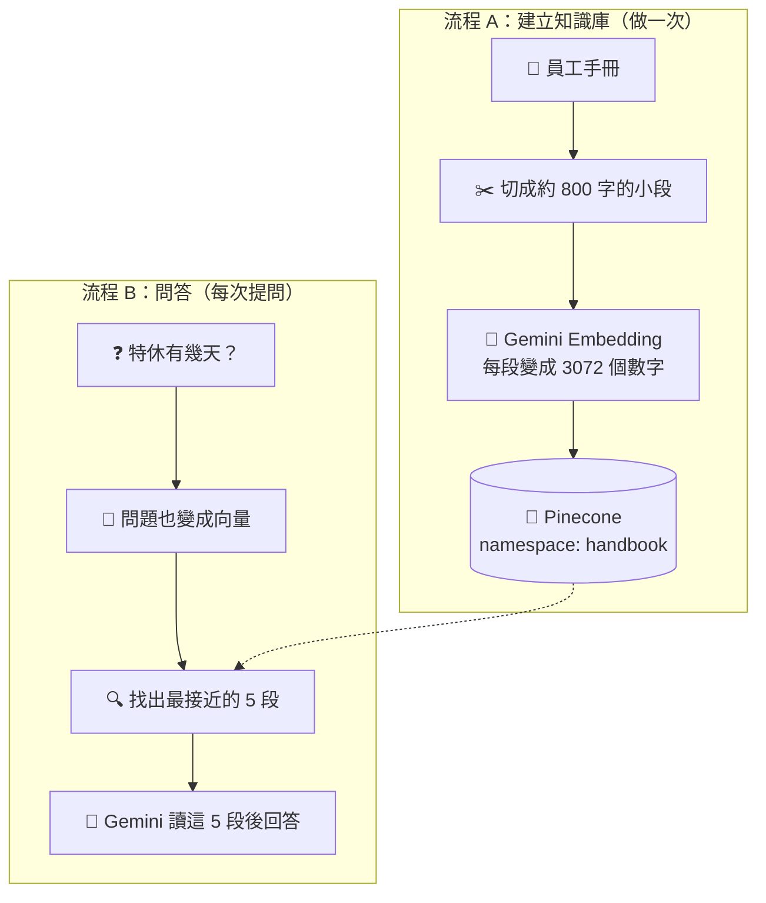
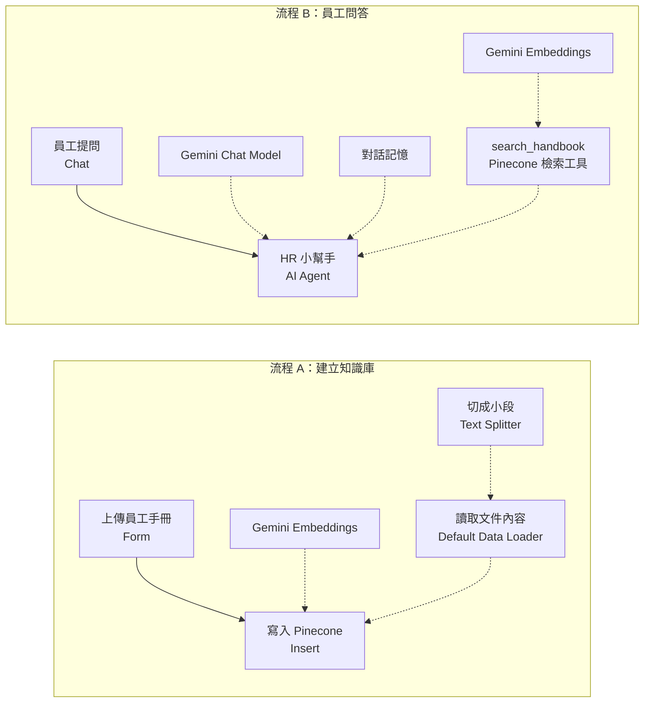

# 範例 05：公司員工手冊問答機器人

新人到職第一週，總有問不完的問題：「特休有幾天？」「加班費怎麼算？」「出差住宿上限多少？」HR 每天回答一樣的問題，員工手冊又厚到沒人想翻。本範例把員工手冊放進 **Pinecone 向量資料庫**，做一個 HR 問答機器人，員工用自己的話提問，AI 就會從手冊裡找到相關段落並回答，還會註明依據哪一章。

這是本章第一個**向量資料庫（RAG）**範例。

### 🎯 本範例功能

- ✅ **上傳就建立知識庫**：用表單上傳手冊檔案，自動切塊、轉向量、存入 Pinecone
- ✅ **語意搜尋**：問「年假」也找得到寫著「特別休假」的段落
- ✅ **只根據手冊回答**：找不到就引導員工詢問 HR，不亂編
- ✅ **註明出處**：每個回答最後標示依據的章節
- ✅ **可重複上傳**：手冊改版時重新上傳，舊資料自動清空

---

## 📄 知識文件

[`星橋數位員工手冊.md`](./星橋數位員工手冊.md)：虛構的「星橋數位科技」員工手冊，約 4,800 字、十個章節：

| 章節 | 內容 | 可以問的問題 |
| :--- | :--- | :--- |
| 二、上班時間與出勤 | 彈性上班、打卡、遠端工作 | 最晚幾點要打卡？可以在家工作嗎？ |
| 三、請假規定 | 特休、病假、婚喪假、生日假 | 我到職 2 年半，特休有幾天？病假有薪水嗎？ |
| 四、加班 | 加班費倍率、補休、誤餐費 | 平日加班 3 小時，加班費怎麼算？ |
| 五、出差與報帳 | 住宿上限、膳雜費、報帳期限 | 去台中出差住宿可以報多少？發票要打什麼統編？ |
| 六、薪資與福利 | 發薪日、三節禮金、各種補助 | 健康檢查有補助嗎？幾號發薪水？ |
| 七、資訊安全 | 密碼規則、AI 工具使用、設備遺失 | 可以用個人 ChatGPT 處理客戶資料嗎？ |

> 💡 手冊故意寫入一些「關鍵字對不上」的內容，讓學生體驗語意搜尋：手冊寫「特別休假」，學生問「年假」；手冊寫「誤餐費」，學生問「加班晚餐可以報嗎」。

---

## 🧠 RAG 是什麼？

**RAG（Retrieval-Augmented Generation，檢索增強生成）** = 先「找資料」，再「生成回答」。

為什麼不把整本手冊直接貼給 AI？
- 手冊很長時會超過 AI 一次能讀的長度，而且每次提問都要付整本手冊的 token 費用。
- RAG 只把**最相關的幾段**交給 AI，又快又省，也比較不會被不相關的內容干擾。

---

## 🚀 工作流程架構

### 節點說明

#### 流程 A：建立知識庫

**1. 上傳員工手冊**（n8n Form Trigger）
- 一個檔案欄位，接受 `.md`、`.txt`。

**2. 寫入 Pinecone**（Pinecone Vector Store：Insert Documents）
| 設定 | 值 | 說明 |
| :--- | :--- | :--- |
| Pinecone Index | `n8n-course` | |
| Options ➔ Pinecone Namespace | `handbook` | 和其他範例的資料分開 |
| Options ➔ Clear Namespace | 開啟 | 寫入前先清空，重複上傳不會有重複資料 |

**3. Gemini Embeddings（寫入）**
- **Model**：`models/gemini-embedding-001`（3072 維）
- ⚠️ 節點畫面上的提示寫著「預設模型 768 維」，那是舊模型 `text-embedding-004` 的說明，請以 Pinecone Index 設定的 **3072** 為準。

**4. 讀取文件內容**（Default Data Loader）
- **Type of Data**：Binary（上傳的檔案）
- **Data Format**：Text
- **Text Splitting**：Custom（使用下方連接的 Text Splitter）
- **Options ➔ Metadata**：`source` = `星橋數位員工手冊`（每一段都會帶上這個標籤）

**5. 切成小段**（Recursive Character Text Splitter）
| 設定 | 值 | 說明 |
| :--- | :--- | :--- |
| Chunk Size | `800` | 每段最多約 800 字元 |
| Chunk Overlap | `150` | 相鄰兩段重疊 150 字元，避免一句話被切斷後意思不完整 |
| Options ➔ Split Code | `markdown` | 優先在 Markdown 標題（`##`）處切開，讓每段盡量是完整的一個小節 |

#### 流程 B：員工問答

**6. 員工提問**（Chat Trigger）

**7. HR 小幫手**（AI Agent）
System Message 重點：
- 每個問題都**必須先用 `search_handbook` 工具搜尋**
- **只能根據手冊回答**，找不到就回答「員工手冊沒有提到…請寄信到 hr@starbridge.example」
- 回答最後註明「📖 依據：第三章 3.1 特別休假」

**8. Google Gemini Chat Model**：`models/gemini-2.5-flash`，Temperature `0.2`

**9. 對話記憶**（Simple Memory）：記住最近 6 輪，可以追問「那病假呢？」

**10. search_handbook**（Pinecone Vector Store：Retrieve Documents (As Tool for AI Agent)）
| 設定 | 值 |
| :--- | :--- |
| Description | 搜尋星橋數位科技的員工手冊，內容包含上班時間、請假、加班… |
| Pinecone Index | `n8n-course` |
| Limit | `5`（每次取回最相關的 5 段） |
| Options ➔ Pinecone Namespace | `handbook` |

> ⚠️ **工具節點請用英文命名**：AI 看到的工具名稱就是節點名稱，n8n 會把中文等特殊字元換成底線 `_`。如果有兩個中文名稱的工具，會變成同樣的 `_` 而互相衝突。

**11. Gemini Embeddings（查詢）**：必須和寫入時**使用同一個模型**。

---

## 📸 工作流程圖

<!-- 截圖請放在 ./images/公司員工手冊問答機器人.png -->

---

## ⚙️ 使用前準備

1. **建立 Pinecone Index**：依照 [Pinecone 設定指南](../Pinecone設定/README.md) 建立 `n8n-course`（3072 維、cosine）並建立憑證。
2. **建立 Gemini 憑證**：參考 [Gemini 與 Gmail 憑證設定](../Gemini與Gmail憑證/README.md)。
3. **匯入工作流**：匯入 [`公司員工手冊問答機器人.json`](./公司員工手冊問答機器人.json)，Pinecone 節點選 **Pinecone** 憑證，Gemini 相關節點選 **Google Gemini** 憑證。
4. **建立知識庫**：
   - 點兩下「上傳員工手冊」➔ **Test step**，在開啟的表單上傳 [`星橋數位員工手冊.md`](./星橋數位員工手冊.md)。
   - 執行完成後到 Pinecone 控制台 ➔ Index `n8n-course` ➔ **Browser**，切換 namespace `handbook`，應該看到約 10 筆向量（實際筆數依切塊結果而定）。
5. **開始提問**：按 **Open chat**，試試：

| 問題 | 預期回答重點 |
| :--- | :--- |
| 我到職兩年半，年假有幾天？ | 10 天（滿 2 年未滿 3 年） |
| 平日加班 3 小時，時薪 200 元，加班費多少？ | 200×1.34×2 + 200×1.67×1 = 870 元 |
| 去台中出差兩天一夜，住宿和膳雜費可以報多少？ | 住宿上限 2,400 元、膳雜費每日 600 元 |
| 加班到很晚可以報晚餐嗎？ | 20:00 後可報誤餐費 150 元 |
| 可以用自己的 ChatGPT 整理客戶資料嗎？ | 不行，請使用公司企業版 AI 工具 |
| 公司有提供員工宿舍嗎？ | 手冊沒有提到，請洽 HR |

> 💡 在 AI Agent 的執行紀錄裡點開 `search_handbook`，可以看到 Pinecone 找回來的 5 段原文和相似度分數，這是理解向量搜尋最好的方式。

---

## 📥 相關檔案下載

- [🚀 下載完整工作流 (JSON)](./公司員工手冊問答機器人.json)
- [📄 員工手冊範例文件](./星橋數位員工手冊.md)

---

**💡 進階應用**：
- 把上傳表單換成 **Google Drive Trigger**，HR 更新雲端硬碟裡的手冊就自動重建知識庫
- 再上傳一份「IT 常見問題」到另一個 namespace，給 AI 兩個工具，讓它自己判斷要查哪一份
- 調整 Chunk Size（例如 300 或 2000）比較回答品質，體驗切塊大小的影響
