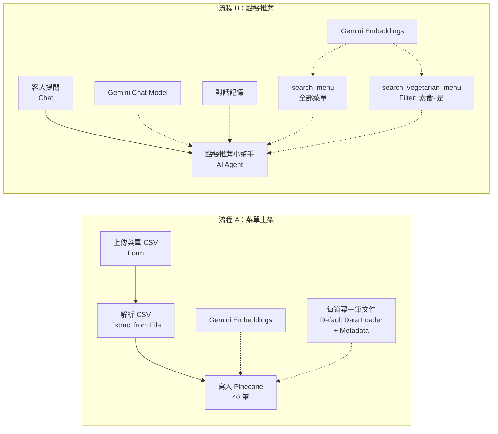

# 範例 06：餐廳菜單智慧推薦

客人走進餐廳最常說的是：「有什麼推薦？」「我不吃辣」「我吃素」「我對花生過敏」「兩個人預算 500」。本範例把「巷弄食堂」的 40 道菜放進 **Pinecone**，每道菜都帶有分類、價格、辣度、素食、過敏原等**標籤（Metadata）**，做出一個懂得看菜單的點餐小幫手。

上一個範例是把「一整份文件」切塊；這個範例學的是**把表格資料（CSV）的每一列變成一筆向量**，並用 **Metadata Filter** 先篩選再搜尋。

### 🎯 本範例功能

- ✅ **CSV 一鍵上架**：上傳菜單 CSV，每道菜自動變成一筆向量
- ✅ **Metadata 標籤**：分類、價格、辣度、素食、過敏原跟著每道菜存進 Pinecone
- ✅ **語意推薦**：「天氣好冷想吃熱的」也能找到鍋物和湯品
- ✅ **Metadata Filter**：素食專用工具只會搜尋 `素食 = 是` 的菜
- ✅ **預算計算**：AI 幫客人算總金額，不超過預算
- ✅ **過敏提醒**：排除含過敏原的菜色

---

## 📄 菜單資料

[`巷弄食堂菜單.csv`](./巷弄食堂菜單.csv)：40 道菜，欄位如下：

| 欄位 | 範例 | 說明 |
| :--- | :--- | :--- |
| `編號` | D01 | 菜色編號 |
| `菜名` | 招牌滷肉飯 | |
| `類別` | 主食 | 主食／鍋物／小菜／湯品／飲料／甜點 |
| `價格` | 60 | |
| `辣度` | 0 | 0 不辣、1 微辣、2 小辣、3 大辣 |
| `素食` | 否 | 是／否（「是」包含全素與蛋奶素，介紹中會註明） |
| `過敏原` | 大豆 | 用「、」分隔 |
| `介紹` | 手切五花肉以醬油、冰糖慢滷 6 小時… | 菜色介紹（語意搜尋主要靠這欄） |

---

## 🏷️ Metadata 與 Metadata Filter

每道菜存進 Pinecone 時，包含兩個部分：

```text
┌───────────────────────────── 一筆向量 ─────────────────────────────┐
│ 文字內容（轉成向量，用來做語意搜尋）                                    │
│   菜名：番茄蔬菜燉飯                                                   │
│   類別：主食  價格：190 元  辣度：0  素食：是  過敏原：乳製品             │
│   介紹：新鮮番茄熬煮醬汁，加入櫛瓜、甜椒、蘑菇與帕瑪森起司，屬蛋奶素。       │
├────────────────────────────────────────────────────────────────────┤
│ Metadata（不轉向量，用來精確篩選）                                      │
│   編號: D05   菜名: 番茄蔬菜燉飯   類別: 主食   價格: 190            │
│   辣度: 0   素食: 是   過敏原: 乳製品                               │
└────────────────────────────────────────────────────────────────────┘
```

| 搜尋方式 | 運作 | 適合 |
| :--- | :--- | :--- |
| **語意搜尋** | 比對「意思」有多接近 | 「想吃熱的」「下飯的」「清爽的」 |
| **Metadata Filter** | 先用標籤**精確**篩選，再做語意搜尋 | 「一定要素食」這種不能出錯的條件 |

> 💡 為什麼素食要用 Filter？只靠語意搜尋，「素食」可能會找到「麻婆豆腐飯」（有豆腐，看起來很素），但它其實有豬絞肉。用 `素食 = 是` 先過濾，就保證不會推薦到葷食。

---

## 🚀 工作流程架構



### 節點說明

#### 流程 A：菜單上架

**1. 上傳菜單 CSV**（n8n Form Trigger）：接受 `.csv`

**2. 解析 CSV**（Extract from File：Extract From CSV）
- **Input Binary Field**：`={{ Object.keys($binary)[0] }}`（自動抓上傳檔案的欄位名稱）
- 輸出 40 筆資料，每筆是一道菜

**3. 寫入 Pinecone**（Pinecone Vector Store：Insert Documents）
- Namespace：`menu`，開啟 **Clear Namespace**

**4. 每道菜一筆文件**（Default Data Loader）
- **Type of Data**：JSON
- **Mode**：Load Specific Data
- **Data**：把欄位組成一段文字（這段文字會被轉成向量）
  ```text
  菜名：{{ $json.菜名 }}
  類別：{{ $json.類別 }}
  價格：{{ $json.價格 }} 元
  辣度：{{ $json.辣度 }}（0 不辣～3 大辣）
  素食：{{ $json.素食 }}
  過敏原：{{ $json.過敏原 }}
  介紹：{{ $json.介紹 }}
  ```
- **Options ➔ Metadata**：`編號`、`菜名`、`類別`、`價格`、`辣度`、`素食`、`過敏原`（CSV 的欄位名稱直接當成 Metadata 名稱）
- 每道菜不到 200 字，不需要額外切塊，一道菜剛好一筆向量

**5. Gemini Embeddings（寫入）**：`models/gemini-embedding-001`

#### 流程 B：點餐推薦

**6. 點餐推薦小幫手**（AI Agent）
System Message 重點：
- 客人提到吃素時**一定要用 `search_vegetarian_menu`**
- 不吃辣 ➔ 只推薦辣度 0；全素 ➔ 排除「蛋奶素」；過敏 ➔ 排除含該過敏原的菜並提醒告知店員
- 有預算時計算總金額，不可超過
- 推薦 2～4 道，每道寫菜名、價格、推薦理由

**7. Google Gemini Chat Model**：Temperature `0.5`（推薦語可以活潑一點）

**8. search_menu**（Pinecone：Retrieve Documents (As Tool)）
- Namespace：`menu`，Limit：`8`

**9. search_vegetarian_menu**（Pinecone：Retrieve Documents (As Tool)）
- Namespace：`menu`，Limit：`8`
- **Options ➔ Metadata Filter**：Name `素食`，Value `是`

---

## 📸 工作流程圖

<!-- 截圖請放在 ./images/餐廳菜單智慧推薦.png -->

---

## ⚙️ 使用前準備

1. **Pinecone 與 Gemini**：同 [範例 05](../05_公司員工手冊問答機器人/README.md)，共用 Index `n8n-course`。
2. **匯入工作流**：匯入 [`餐廳菜單智慧推薦.json`](./餐廳菜單智慧推薦.json)，選擇 Pinecone 與 Gemini 憑證。
3. **菜單上架**：點兩下「上傳菜單 CSV」➔ **Test step**，上傳 [`巷弄食堂菜單.csv`](./巷弄食堂菜單.csv)。到 Pinecone Browser 切換 namespace `menu`，應該有 **40 筆**。
4. **開始點餐**：按 **Open chat**，試試：

| 客人說 | 預期 |
| :--- | :--- |
| 我不吃辣，想吃素，預算 250 有什麼推薦？ | 使用 `search_vegetarian_menu`；推薦辣度 0 的素食，例如番茄蔬菜燉飯、炸豆腐、玉米濃湯，總價 ≤ 250 |
| 我吃全素，有什麼主食？ | 排除番茄燉飯、青醬義大利麵（蛋奶素），推薦蔬食咖哩飯、三杯杏鮑菇飯、素食麻婆豆腐飯 |
| 天氣好冷，想吃熱呼呼的 | 語意搜尋找到麻油雞腿麵線、鍋物、湯品 |
| 我超愛吃辣，越辣越好 | 推薦辣度 3：川味紅油抄手、麻婆豆腐飯、麻辣鴨血豆腐鍋、口水雞 |
| 我對花生過敏，想吃點心和甜點 | 排除川味口水雞、花生湯圓，並提醒告知店員 |
| 兩個大人一個小孩，預算 600，幫我配一餐 | 主食 + 小菜 + 湯，計算總金額 |

> 🔬 **小實驗**：把 System Message 中「吃素時一定要用 search_vegetarian_menu」刪掉，再問「我吃素」，觀察 AI 是否推薦到葷食，體會 Metadata Filter 的價值。

---

## 📥 相關檔案下載

- [🚀 下載完整工作流 (JSON)](./餐廳菜單智慧推薦.json)
- [📄 菜單資料 (CSV)](./巷弄食堂菜單.csv)

---

**💡 進階應用**：
- 新增「不吃辣專用工具」：Metadata Filter `辣度 = 0`
- 把菜單放到 Google Sheets，店家改價格後自動重新上架
- 推薦完成後，用 Supabase 記錄客人點了什麼，累積「熱門推薦」資料
