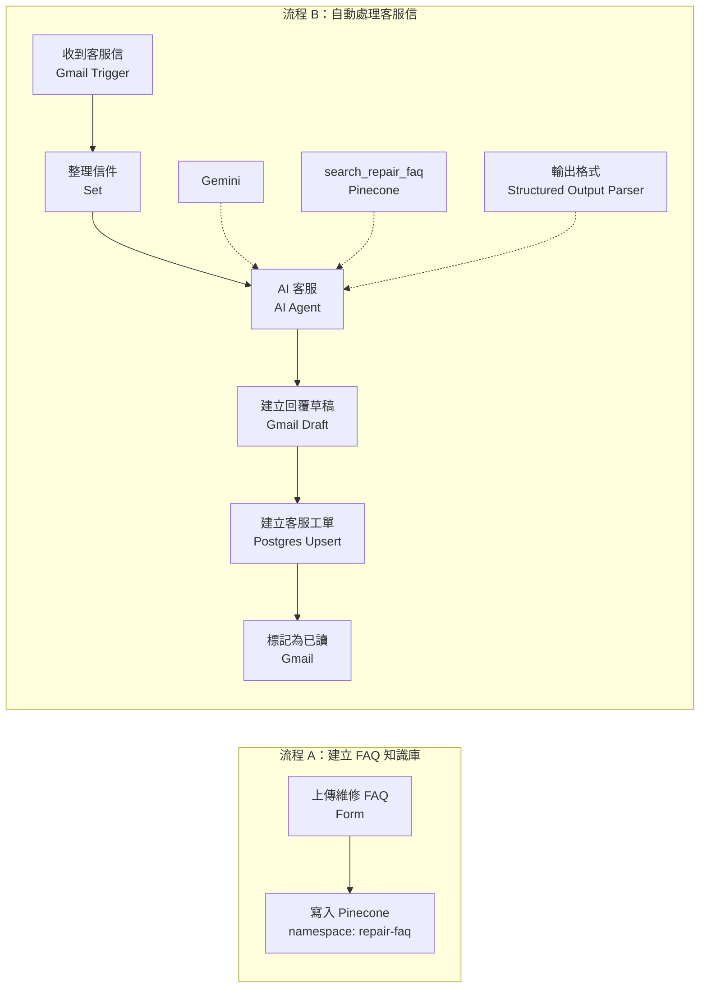

# 範例 07：維修中心客服信自動回覆（總結範例）

「快修通 3C 維修中心」每天收到幾十封客服信，問的大多是一樣的事：換螢幕多少錢、送修要多久、手機泡水怎麼辦。本範例讓 n8n 自動讀取客服信，AI 到 **Pinecone** 查 FAQ 寫好回覆，存成 **Gmail 草稿**給客服人員審核後再寄出，同時在 **Supabase** 建立一張客服工單，主管可以隨時統計各類問題的數量。

這是本章的總結範例，**兩種資料庫各司其職**：

| | 🌲 Pinecone | 🐘 Supabase |
| :--- | :--- | :--- |
| 存什麼 | FAQ 文件切塊 | 客服工單（誰、什麼問題、處理狀態） |
| 用來 | 找出能回答客人問題的段落 | 記錄、統計、追蹤進度 |
| 查詢方式 | 語意相似度 | SQL |

### 🎯 本範例功能

- ✅ **自動讀信**：Gmail 每分鐘檢查主旨含「維修」的未讀信
- ✅ **AI 分類**：保固查詢／維修費用／送修流程／故障排除／進度查詢／其他
- ✅ **判斷緊急程度**：進水、電池膨脹等標記為「緊急」
- ✅ **根據 FAQ 回覆**：只用 FAQ 的資訊回答，找不到就轉人工
- ✅ **人工審核**：只建立**草稿**，不直接寄出，避免 AI 回錯話
- ✅ **工單紀錄**：Upsert 到 Supabase，同一封信不會建立兩張工單
- ✅ **結構化輸出**：用 Structured Output Parser 讓 AI 一定回傳固定格式的 JSON

---

## ⚙️ 使用前準備

1. **建立工單資料表**：Supabase ➔ **SQL Editor**，執行 [`setup.sql`](./setup.sql)。
2. **憑證**：需要 **Supabase Postgres**、**Pinecone**、**Google Gemini**、**Gmail** 四種憑證（見 [Supabase 設定](../Supabase設定/README.md)、[Pinecone 設定](../Pinecone設定/README.md)、[Gemini 與 Gmail 憑證](../Gemini與Gmail憑證/README.md)）。
3. **匯入工作流**：匯入 [`維修中心客服信自動回覆.json`](./維修中心客服信自動回覆.json)，逐一選擇憑證。
4. **建立 FAQ 知識庫**：點兩下「上傳維修 FAQ」➔ **Test step**，上傳 [`快修通維修服務FAQ.md`](./快修通維修服務FAQ.md)。
5. **寄測試信**：依照 [`測試信件範例.md`](./測試信件範例.md)，用另一個信箱寄信給 n8n 綁定的 Gmail。
6. **測試**：
   - 點兩下「收到客服信」➔ **Fetch Test Event** 抓取最新的信，再按 **Execute workflow**。
   - 到 Gmail **草稿**查看 AI 寫的回覆。
   - 到 Supabase **Table Editor** ➔ `維修工單` 查看新工單。
   - 到 SQL Editor 執行 `SELECT * FROM 維修工單統計;` 看各分類統計。
7. **正式啟用**：切換為 **Active**，之後每分鐘自動處理新信件。

> ⚠️ **Gemini 免費額度**：每封信會呼叫 Gemini 數次（判斷、查詢、生成），一次寄很多封測試信可能遇到 `429 Too Many Requests`，請一封一封測試。

---

## 📄 範例資料

| 檔案 | 說明 |
| :--- | :--- |
| [`快修通維修服務FAQ.md`](./快修通維修服務FAQ.md) | 26 題 FAQ：營業資訊、保固、送修流程、維修價目表、故障排除 |
| [`setup.sql`](./setup.sql) | 建立 `維修工單` 資料表、`維修工單統計` 檢視表，並放入 4 筆歷史工單 |
| [`測試信件範例.md`](./測試信件範例.md) | 5 封測試信與預期結果，複製後寄給自己即可測試 |

---

## 🚀 工作流程架構



### 節點說明

#### 流程 A：建立 FAQ 知識庫
和 [範例 05](../05_公司員工手冊問答機器人/README.md) 相同：Form 上傳 ➔ Default Data Loader（Text）➔ Text Splitter（Chunk Size `600`、Overlap `100`、Markdown）➔ Gemini Embeddings ➔ Pinecone（namespace `repair-faq`，Clear Namespace）。

#### 流程 B：自動處理客服信

**1. 收到客服信**（Gmail Trigger）
| 設定 | 值 | 說明 |
| :--- | :--- | :--- |
| Poll Times | Every Minute | 每分鐘檢查一次 |
| Simplify | 關閉 | 才能取得完整的寄件人、信件內文 |
| Filters ➔ Search | `subject:維修 is:unread` | 和 Gmail 搜尋框語法相同 |

**2. 整理信件**（Edit Fields / Set）
| 欄位 | 值 |
| :--- | :--- |
| `郵件編號` | `={{ $json.id }}` |
| `對話串編號` | `={{ $json.threadId }}` |
| `寄件人信箱` | `={{ $json.from.value[0].address }}` |
| `寄件人姓名` | `={{ $json.from.value[0].name \|\| $json.from.value[0].address }}` |
| `主旨` | `={{ $json.subject }}` |
| `信件內容` | `={{ ($json.text \|\| '').slice(0, 3000) }}`（太長的信只取前 3000 字） |

**3. AI 客服**（AI Agent）
- **Source for Prompt**：Define below，把寄件人、主旨、內文組成提示
- **Require Specific Output Format**：開啟（連接下方的 Structured Output Parser）
- System Message 規定：先用 `search_repair_faq` 查 FAQ ➔ 只根據 FAQ 回答 ➔ 輸出 5 個欄位

**4. 輸出格式**（Structured Output Parser）
- 用 JSON 範例定義格式，AI 的回答會被解析成物件，後面的節點可以直接用 `$json.output.問題分類`：
```json
{
  "問題分類": "維修費用",
  "緊急程度": "一般",
  "問題摘要": "詢問 iPhone 14 換螢幕價格與時間",
  "知識庫有答案": true,
  "回覆內容": "您好，感謝您來信快修通 3C 維修中心。\n..."
}
```

**5. search_repair_faq**（Pinecone：Retrieve Documents (As Tool)）
- Namespace：`repair-faq`，Limit：`5`

**6. 建立回覆草稿**（Gmail：Draft ➔ Create）
| 設定 | 值 |
| :--- | :--- |
| Subject | `=Re: {{ $('整理信件').item.json.subject }}` |
| Message | `={{ $json.output.回覆內容 }}` |
| Options ➔ Thread ID | `={{ $('整理信件').item.json.對話串編號 }}`（草稿會出現在原本的信件串裡） |
| Options ➔ To Email | `={{ $('整理信件').item.json.寄件人信箱 }}` |

> 💡 **為什麼不直接寄出？** AI 偶爾會誤解問題或用錯語氣。讓 AI 做 90% 的工作、真人花 10 秒審核再按「傳送」，是企業導入 AI 客服最常見也最安全的做法（Human-in-the-loop）。

**7. 建立客服工單**（Postgres：Insert or Update）
- **Table**：`維修工單`
- **Columns to match on**：`郵件編號`（同一封信再跑一次會更新而不是新增）
- 欄位對應：

| 欄位 | 值 |
| :--- | :--- |
| `郵件編號`、`顧客信箱`、`主旨` | 來自「整理信件」 |
| `問題分類`、`緊急程度`、`問題摘要`、`知識庫有答案` | 來自 `$('AI 客服').item.json.output` |
| `處理狀態` | `={{ ...知識庫有答案 ? '草稿待審' : '需人工處理' }}` |

- 🔍 **底層對應的 SQL（Upsert）與統計查詢**（可在 Supabase SQL Editor 測試）：
  n8n 的 **Insert or Update** 節點在 PostgreSQL 底層其實是執行 `ON CONFLICT (...) DO UPDATE`：
  ```sql
  -- 1. 新增工單；若「郵件編號」已存在，就更新原有那一列（不會產生重複工單）
  INSERT INTO 維修工單 (郵件編號, 顧客信箱, 主旨, 問題分類, 緊急程度, 問題摘要, 知識庫有答案, 處理狀態)
  VALUES ('demo-999', 'test@example.com', '請問維修 iPhone 換電池多少錢', '維修費用', '一般', '詢問 iPhone 換電池價格', TRUE, '草稿待審')
  ON CONFLICT (郵件編號) DO UPDATE SET
    問題分類     = EXCLUDED.問題分類,
    緊急程度     = EXCLUDED.緊急程度,
    問題摘要     = EXCLUDED.問題摘要,
    知識庫有答案 = EXCLUDED.知識庫有答案,
    處理狀態     = EXCLUDED.處理狀態
  RETURNING *;

  -- 2. 主管隨時查看各分類工單數量、緊急件與需人工處理件數（查詢 View）
  SELECT
    問題分類,
    COUNT(*)                                  AS 工單數,
    COUNT(*) FILTER (WHERE 緊急程度 = '緊急') AS 緊急件,
    COUNT(*) FILTER (WHERE NOT 知識庫有答案)  AS 需人工處理
  FROM 維修工單
  GROUP BY 問題分類
  ORDER BY 工單數 DESC;
  ```

> ⚠️ **中文欄位名稱裡不要混用大寫英文字母**：PostgreSQL 會把沒加引號的英文自動轉成小寫，例如建表時寫 `FAQ有答案`，實際欄位會變成 `faq有答案`，n8n 用原本的名稱就對不上。純中文（例如 `知識庫有答案`）沒有這個問題。

**8. 標記為已讀**（Gmail：Message ➔ Mark as Read）
- 處理完的信標記為已讀，Gmail Trigger 就不會再抓到它。

---

## 📸 工作流程圖

<!-- 截圖請放在 ./images/維修中心客服信自動回覆.png -->

---

## 📥 相關檔案下載

- [🚀 下載完整工作流 (JSON)](./維修中心客服信自動回覆.json)
- [📜 工單資料表 (setup.sql)](./setup.sql)
- [📄 維修 FAQ 文件](./快修通維修服務FAQ.md)
- [✉️ 測試信件範例](./測試信件範例.md)

---

**💡 進階應用**：
- 依 `問題分類` 自動幫信件加上 Gmail 標籤（例如「維修/費用」「維修/緊急」）
- `緊急程度 = 緊急` 時，另外寄一封通知給店長
- 每天下班前查詢 `處理狀態 = '需人工處理'` 的工單，寄出待辦清單給客服主管
- 客服按下傳送後，用另一個工作流把工單狀態更新為「已回覆」
