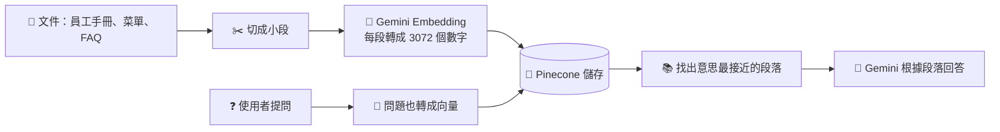

# Pinecone 註冊與 n8n 連線設定

本章後三個範例（05～07）使用 **Pinecone** 向量資料庫，讓 AI 能「依照意思」而不是「依照關鍵字」找資料。這份指南帶您完成：註冊免費帳號 ➔ 建立索引 (Index) ➔ 在 n8n 建立憑證。約 5 分鐘，**免費、不用綁信用卡**。

---

## 📋 向量資料庫是什麼？跟 Supabase 有什麼不同？

| | 🐘 Supabase（關聯式資料庫） | 🌲 Pinecone（向量資料庫） |
| :--- | :--- | :--- |
| **存什麼** | 表格：訂單、會員、庫存 | 文字轉成的「向量」（一長串數字） |
| **怎麼查** | `WHERE price < 200` 精確條件 | 「跟這句話意思最接近的段落」 |
| **擅長** | 計算、統計、狀態管理 | 讓 AI 從文件找答案（RAG） |
| **本章範例** | 01～04 | 05～07（07 兩個一起用） |

> 💡 **舉例**：員工手冊寫的是「特別休假」，學生問「我可以請幾天年假？」——關鍵字完全對不上，但向量資料庫知道兩者意思相近，所以找得到。

---

## 🚀 第一步：註冊 Pinecone 免費帳號

1. 前往 [Pinecone 官方網站](https://www.pinecone.io/)，點選 **Sign up**，用 Google 或 GitHub 帳號登入。
2. 系統自動套用免費的 **Starter** 方案，不需要填寫付款資訊。

---

## 🗂️ 第二步：建立索引 (Index)

本章三個範例**共用同一個 Index**，用不同的 **Namespace（命名空間）** 區隔資料，就像同一個資料庫裡的不同資料夾。

1. 進入 Pinecone 控制台，點選 **Database** ➔ **Indexes** ➔ **Create index**。
2. 填寫設定：

| 欄位 | 設定值 | 說明 |
| :--- | :--- | :--- |
| **Index name** | `n8n-course` | 範例工作流預設使用這個名稱 |
| **Configuration** | 選 **Custom settings**（手動設定） | 不要選 Pinecone 內建的 Embedding 模型 |
| **Vector type** | `Dense` | |
| **Dimension** | **`3072`** | ⚠️ 必須和 Gemini `gemini-embedding-001` 輸出的維度相同 |
| **Metric** | `cosine` | |
| **Capacity mode** | `Serverless` | |
| **Cloud / Region** | `AWS` / `us-east-1` | ⚠️ 免費方案只能選這個區域 |

3. 點選 **Create index**，幾秒後完成。

> ⚠️ **Dimension 建立後不能修改**。如果填錯，只能刪除 Index 重建。
> 執行時出現 `Vector dimension 768 does not match the dimension of the index 3072` 這類錯誤，就是 Embedding 模型和 Index 維度不一致。

### 本章使用的 Namespace

| 範例 | Namespace | 存放內容 |
| :--- | :--- | :--- |
| 05 公司員工手冊問答機器人 | `handbook` | 員工手冊切塊 |
| 06 餐廳菜單智慧推薦 | `menu` | 40 道菜，每道一筆 |
| 07 維修中心客服信自動回覆 | `repair-faq` | 維修 FAQ 切塊 |

Namespace 不用事先建立，n8n 第一次寫入時會自動產生。在 Pinecone 控制台點進 Index ➔ **Browser** 可以切換 Namespace 查看資料。

---

## 🔑 第三步：取得 API Key

1. 左側選單點選 **API keys** ➔ **Create API key**。
2. 名稱填 `n8n`，按 **Create key**，複製以 `pcsk_` 開頭的金鑰。

> ⚠️ 金鑰只會顯示一次，請立即貼到 n8n 憑證中。

---

## 🔐 第四步：在 n8n 建立憑證

1. n8n 左側選單 **Credentials** ➔ **Add Credential** ➔ 搜尋 **Pinecone**。
2. **API Key** 貼上剛才的金鑰，憑證名稱改為 `Pinecone`，點 **Save**。

範例中的 AI 與 Embedding 還需要 **Google Gemini** 憑證，請參考 [Gemini 與 Gmail 憑證設定](../Gemini與Gmail憑證/README.md)。

---

## ⚠️ 常見問題

| 問題現象 | 原因 | 解決方式 |
| :--- | :--- | :--- |
| **dimension does not match** | Index 維度 ≠ Embedding 輸出維度 | 確認 Embedding 節點選 `models/gemini-embedding-001`，Index 為 3072 維 |
| **Index 下拉選單是空的** | 憑證錯誤或 Index 尚未建立完成 | 重新檢查 API Key，或等 Index 狀態變為 Ready |
| **AI 回答「找不到相關資料」** | 該 Namespace 還沒寫入資料 | 先執行範例中的「建立知識庫」流程 |
| **同一份文件重複出現好幾次** | 上傳了多次 | 範例的寫入節點已開啟 **Clear Namespace**，每次上傳會先清空再寫入 |
