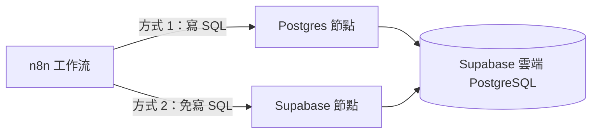

# Supabase 註冊與 n8n 連線設定

本章前四個範例（01～04）都使用 **Supabase** 提供的雲端 PostgreSQL 資料庫。這份指南帶您完成：建立免費專案 ➔ 取得連線參數 ➔ 在 n8n 建立憑證。整個過程約 10 分鐘，**完全免費、不用綁信用卡**。

---

## 📋 為什麼選擇 Supabase？



- ✅ **標準 PostgreSQL**：學到的 SQL 語法到哪裡都能用。
- ✅ **像 Excel 的網頁介面**：Table Editor 可以直接看到、修改資料，非常適合上課展示。
- ✅ **兩種連線方式**：
  - **Supabase 節點**：用下拉選單選資料表與欄位，免寫 SQL（範例 01）。
  - **Postgres 節點**：直接寫 SQL，可以做 JOIN、統計、日期運算（範例 02～04、07）。
- ✅ **免費方案**：每個帳號可建立 2 個免費專案，每個專案 500 MB 資料庫空間，上課綽綽有餘。

> ⚠️ **免費專案 7 天沒有使用會自動暫停**。暫停後到 Supabase 控制台按 **Restore project** 即可恢復，資料不會遺失。

---

## 🚀 第一步：建立 Supabase 專案

1. 前往 [Supabase 官方網站](https://supabase.com/)，點選 **Start your project**，用 GitHub 或 Email 註冊登入。
2. 點選 **New project**：
   - **Project name**：`n8n-course`
   - **Database Password**：按 **Generate a password** 產生一組密碼，**務必複製保存**（之後 n8n 連線要用）。
   - **Region**：選 **Northeast Asia (Tokyo)** 或 **Southeast Asia (Singapore)**，離台灣比較近、速度較快。
3. 點選 **Create new project**，等待約 1～2 分鐘完成建立。

---

## 🔑 第二步：取得連線參數

> ⚠️ **重要觀念：這兩種連線用的「密碼／金鑰」完全不同，切勿混用！**
>
> | 連線方式 | 使用場景 | 驗證用的密碼／金鑰 | 取得位置 |
> | :--- | :--- | :--- | :--- |
> | **(1) 資料庫直連（PostgreSQL）** | **DBeaver**、n8n **Postgres 節點**（範例 02～04、07） | **資料庫密碼（Database Password）**，即建立專案時設定的密碼 | 專案上方 **Connect** ➔ **Session pooler** |
> | **(2) Data API（HTTP）** | n8n **Supabase 節點**（範例 01） | **API Secret Key**（`sb_secret_...` 金鑰） | **Integrations ➔ Data API** 與 **Project Settings ➔ API Keys** |
>
> - 透過 **DBeaver** 或 **Postgres 節點** 連線時，用的是「**資料庫密碼**」。
> - 透過 **Supabase 節點（Data API）** 連線時，用的是「**Secret Key**（`sb_secret_...`）」，與資料庫密碼是**完全不同的東西**。

### (1) Postgres 節點用：資料庫連線參數（範例 02、03、04、07 與 DBeaver 使用）

> 💡 **做範例 01（社團活動報名系統）用不到這一段**，可直接跳到下方的 **(2) Supabase 節點用：API 參數**。

1. 在專案頁面上方點選 **Connect** 按鈕。
2. 切換到 **Connection String** 分頁，Method 選 **Session pooler**（支援 IPv4，大部分網路環境都能連）。
3. 點選 **View parameters**，記下以下參數：

| 參數 | 範例值 | 說明 |
| :--- | :--- | :--- |
| **Host** | `aws-0-ap-northeast-1.pooler.supabase.com` | 每個專案不同 |
| **Port** | `5432` | Session pooler 使用 5432 |
| **Database** | `postgres` | 固定 |
| **User** | `postgres.abcdefghijklmnop` | `postgres.` 後面接您的專案代碼 |
| **Password** | 建立專案時的資料庫密碼 | 與 **DBeaver** 連線用的是同一組密碼；忘記可到 Project Settings ➔ Database 重設 |

### (2) Supabase 節點用：API 參數（範例 01 使用）

1. 點選左側 **Integrations** ➔ **Data API**（或在 **Project Settings** 左側的 **INTEGRATIONS** 區塊點 **Data API**），複製 **URL**（例如 `https://abcdefghijklmnop.supabase.co`；**若複製到的網址結尾有 `/rest/v1` 或 `/rest/v1/`，填入 n8n 時務必刪除**）。
2. 點選左側 **Project Settings**（齒輪圖示）➔ **API Keys**，在 **Secret keys** 區塊複製 **default** 金鑰（以 `sb_secret_` 開頭；勿複製上方的 **Publishable key**。若需要舊版 `service_role` 金鑰，可點上方 **View legacy API keys**）。

> ⚠️ **這裡用的是 API Secret Key（`sb_secret_...`），不是 DBeaver／建立專案時的資料庫密碼！** Secret key（及舊版 service_role）擁有最高 API 權限，可以略過資料表的 RLS 安全規則。只能放在 n8n 憑證裡，**絕對不要貼到網頁前端或公開的 GitHub**。

---

## 🔐 第三步：在 n8n 建立憑證

### 憑證 A：Postgres（範例 02、03、04、07 使用）

1. n8n 左側選單 **Credentials** ➔ **Add Credential** ➔ 搜尋 **Postgres**。
2. 填入第二步 (1) 的參數：
   - **Host**、**Database**、**User**、**Password**、**Port**
   - **SSL**：選 **Require**
   - **Ignore SSL Issues**：開啟
3. 憑證名稱改為 `Supabase Postgres`，點 **Save**，出現 `Connection tested successfully` 即成功。

### 憑證 B：Supabase API（範例 01 使用）

1. **Add Credential** ➔ 搜尋 **Supabase**，右上角驗證方式保持 **Secret Key**。
2. 填入第二步 (2) 的參數：
   - **Host**：貼上 Project URL（例如 `https://abcdefghijklmnop.supabase.co`；**設定時不要有結尾的 `/rest/v1` 或 `/rest/v1/`**，只保留到 `.supabase.co`）。
   - **Secret Key**（舊版 n8n 顯示為 Service Role Secret）：貼上 **Secret key**（`sb_secret_` 開頭，或舊版 `service_role` 金鑰）。
3. 憑證名稱改為 `Supabase API`，點 **Save**，出現 `Connection tested successfully` 即成功。

---

## 📜 第四步：執行範例的建表腳本

每個範例資料夾都附一份 `setup.sql`，裡面包含**建立資料表**與**自動產生的測試資料**，不需要自己準備任何資料：

1. Supabase 左側選單點選 **SQL Editor** ➔ **New query**。
2. 打開範例資料夾裡的 `setup.sql`，全部複製貼上，按 **Run**（或 `Ctrl/Cmd + Enter`）。
3. 到左側 **Table Editor** 就能看到資料表和測試資料。

> 💡 每份 `setup.sql` 都可以**重複執行**：會先刪除該範例的舊資料表再重建，資料玩壞了隨時重跑一次就恢復原狀。不同範例的資料表名稱不會互相衝突。

### 🀄 資料表與欄位都用中文命名

本章所有範例的資料表和欄位都是**繁體中文**（例如 `社團活動`、`早餐訂單`、`活動名稱`、`訂單金額`），讓 SQL 和 n8n 節點輸出一看就懂：

```sql
SELECT 品名, 單價 FROM 早餐品項 WHERE 類別 = '飲料' ORDER BY 單價 DESC;
```

- PostgreSQL 可以直接用中文當名稱，**不需要加雙引號**。
- n8n 的 Supabase 節點、Postgres 節點都能正常選到中文資料表與欄位；在表達式中寫成 `{{ $json.活動名稱 }}` 即可。
- ⚠️ **自己建表時，名稱不要混用大寫英文字母**（例如 `FAQ有答案`）。PostgreSQL 會把沒加引號的英文自動轉成小寫，實際欄位會變成 `faq有答案`，之後在 n8n 中選欄位就會對不上。只用中文、或只用小寫英文就不會有問題。

---

## ⚠️ 常見連線問題

| 問題現象 | 原因 | 解決方式 |
| :--- | :--- | :--- |
| **Connection timeout / ENETUNREACH** | 使用了 Direct connection，它只支援 IPv6 | 改用 **Session pooler** 的 Host 與 User |
| **password authentication failed** | 密碼錯誤，或 User 少了 `.專案代碼` | 確認 User 是 `postgres.xxxx` 格式；忘記密碼到 Project Settings ➔ Database 重設 |
| **Tenant or user not found** | User 的專案代碼打錯 | 重新到 **Connect** ➔ **View parameters** 複製 |
| **SSL / self-signed certificate 錯誤** | SSL 設定問題 | SSL 選 **Require** 並開啟 **Ignore SSL Issues** |
| **relation "xxx" does not exist** | 還沒執行該範例的 `setup.sql`，或資料表名稱打錯字 | 到 SQL Editor 執行 `setup.sql`；中文表名請確認一字不差（例如 `早餐訂單` 不是 `早餐訂單表`） |
| **專案連不上、控制台顯示 Paused** | 免費專案 7 天未使用被暫停 | 按 **Restore project** |
| **Supabase API 連線失敗（404 / 測試不過）** | Host 結尾多了 `/rest/v1` 或 `/rest/v1/` | 刪除結尾的 `/rest/v1`（`/rest/v1/`），只保留 `https://專案代碼.supabase.co` |
